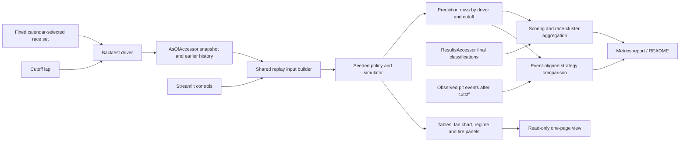

# Phase 6: MVP Backtest, Streamlit View & README - Research

**Researched:** 2026-11-14
**Domain:** Walk-forward evaluation of stochastic race strategy, Streamlit dashboard  
**Confidence:** MEDIUM

<user_constraints>
## User Constraints (from CONTEXT.md)

### Locked Decisions

#### Race selection and aggregation
- **D-01:** Before scoring, pre-register ten complete races from 2023–2025, spread across years (4/3/3 when the catalog supports it) and selected using calendar order, season, round, and data completeness only. Include Bahrain 2023 as the fixed reference race. Do not select or replace races based on their outcomes or model metrics.
- **D-02:** Evaluate eligible as-of cutoffs in chronological order, using only earlier completed in-sample history. Average observations within each race, weight the ten races equally, and form uncertainty intervals by resampling whole races so repeated laps and drivers do not act like independent races.

#### Probability scores and uncertainty coverage
- **D-03:** Report Brier scores for podium and top-10 outcomes beside a probabilistic grid-position baseline learned only from earlier races. Use a conservative neutral prior when the first evaluation race has no usable earlier results. Report the model and baseline on the same drivers and cutoffs.
- **D-04:** Build each driver's 90% finishing-position interval from the central empirical interval of simulated outcomes at that cutoff. Report observed coverage with race-clustered uncertainty; do not tune the interval on the ten evaluation races.
- **D-05:** Measure Phase 4's real-data wear-band follow-up as a retrospective diagnostic against a leave-current-stint-out reference. Label this as a proxy rather than latent ground truth, report early-fit bias and own-laps double-counting evidence, and do not change the filter merely to make this diagnostic look better.

#### Platform recommendations and observed team stops
- **D-06:** Pair each recommendation with the next observed pit event using the decision available before that event. Report top-action agreement and stop-timing error per race with 95% race-cluster bootstrap intervals. Describe this as comparison with observed team behavior, not proof that the platform beats teams.

#### Streamlit page and defaults
- **D-07:** Build one read-only page with the required strategy table, finishing-position fan chart, regime gauge, tire estimate and uncertainty panel, reason line, and risk dial. Provide race, driver, cutoff-lap, and risk controls. Default to Bahrain 2023, ALO, a middle eligible cutoff, and risk aversion 0.5.
- **D-08:** Reuse cutoff-safe replay inputs and show the existing safety-car probability as the regime view; do not imply that Phase 8's Markov regime model exists. Clearly label prior-driven or sparse-fallback output as uncalibrated. Add Streamlit as a project dependency as required by the roadmap, without adding deployment or live streaming.
- **D-10:** Resolve the Phase 6 UI review findings against the approved `06-UI-SPEC.md`: use its exact replay error copy without showing raw exception text; mark the actual first-ranked table action with the accent; keep fan-chart bars neutral and use the accent for a clearly labeled summary marker from the selected cutoff's simulation; bring chart text, spacing, and control sizing into the declared design scale where native widgets permit. Show the risk slider endpoints visibly. Validate the rendered page at desktop and narrow widths.
- **D-11:** Replace the current flat Streamlit presentation with a polished motorsport race-engineering dashboard. Use a dark graphite canvas, layered slate surfaces, crisp high-contrast type, and deliberate spacing; use racing red only for the primary action and the existing top-ranked, finishing-summary, and safety-car signals. Make the fixed ten-race scorecard compact, make the replay controls easy to scan, give the finishing-position chart visual priority, and present safety-car and tire estimates as tidy companion cards. Keep the page one-screen-flow, read-only, cutoff-safe, and free of new features or dependencies. This owner feedback supersedes the prior light visual palette and flat component treatment; it does not change D-07/D-08 data, copy, or scope requirements.
- **D-12:** Use a light, warm editorial race strategy desk with ink-dark typography, generous alignment, a measured type/spacing scale, restrained racing red, and only the borders needed to clarify grouping.
  - Rebuild the page as a light, warm editorial race strategy desk with ink-dark typography, generous alignment, a measured type/spacing scale, restrained racing red, and only the borders needed to clarify grouping.
  - Remove the heavy graphite canvas, proliferated outlines, and nested card-in-card surfaces from D-11. Let spacing, typography, and alignment provide most of the hierarchy.
  - Use the actual finishing-distribution chart and other existing report data as the principal graphics. A small original vector accent may support the racing identity, but it must not imply measured data, copy Formula 1 marks, or compete with the replay.
- **D-13:** Make the replay the first and clearest task.
  - Present the app identity and one-sentence purpose briefly, then lead with the race/driver/cutoff/risk controls and the selected replay result. The results chart is the main graphic; safety-car probability, tire estimate, and strategy table are organized around it.
  - Move the fixed ten-race evidence below the selected replay as a concise, quieter section. Preserve every reported value, interval, denominator, count, and its existing meaning; ensure long values wrap instead of clipping.
  - Populate the default Bahrain 2023 / ALO / middle-cutoff / 0.5 replay on the first usable view if the measured load time is acceptable and the result is cached by the existing inputs/cache identity. Keep the submit action for later selection changes and suppress stale results.
- **D-14:** Redesign the entire one-page experience.
  - Apply the redesign consistently to the masthead and scope note, first-load/empty/error states, replay controls, results panels, chart, strategy table/reason, fixed benchmark, and explanatory/source notes.
  - Retain the one-page, read-only, cutoff-safe scope and current controls/defaults. No tabs, live mode, deployment, new metrics, copied F1 imagery/marks, or new dependencies.
  - Ensure the desktop layout has a strong content grid and the narrow layout stacks naturally with no clipped labels/values; keep the full table reachable by scrolling when needed.
- **D-15:** Only use a pre-race race-distance horizon.
  - Repair the current default replay failure by supplying a race horizon from an authoritative schedule fact available independently of completed-race outcomes. Keep provenance beside any bundled or transformed schedule metadata.
  - If an eligible event has no trustworthy pre-race horizon, make that event unavailable with clear recovery guidance; never infer scheduled laps from OpenF1 completed-lap counts, result laps, the last observed lap, or another post-race field.
  - Preserve the existing cutoff accessor, outcome separation, and 2026 out-of-sample boundary.

### the agent's Discretion
- The exact ten race IDs within the pre-registered season/round rule, with Bahrain 2023 fixed and the full list recorded before scoring.
- The smoothing details for the past-only grid baseline, the bootstrap implementation, app module layout, caching, and chart styling, provided the decisions above and existing data-access boundaries remain intact.
- The exact spacing, card shape, heading treatment, and chart grid/annotation details for D-12 through D-14, provided contrast, accessibility, responsive behavior, and the locked data semantics remain intact.

### Deferred Ideas (OUT OF SCOPE)
- 20-race per-era evaluation and the one-time 2026 holdout — Phase 8.
- Hierarchical Bayesian pace model — Phase 7.
- Markov regime model and regime-dependent pit loss — Phase 8.
- Live OpenF1 streaming, production deployment, market-odds benchmarking, and a broader dashboard — later milestones or out of scope.
</user_constraints>

<phase_requirements>
## Phase Requirements

| ID | Description | Research Support |
|----|-------------|------------------|
| BKT-01 | A walk-forward backtester runs races from 2023–2025 with zero look-ahead | Use the existing `AsOfAccessor`, earlier-race `History`, replay builder pattern, results boundary and future-scramble consumer guard. |
| BKT-02 | Backtest reports Brier score (podium, top-10) vs a grid-position baseline and 90% finishing-interval coverage | Store model/baseline probabilities on identical driver-cutoff rows; score and report per race before equal-race aggregation; central empirical simulated intervals. |
| BKT-04 | Strategy calls are compared with actual team calls, with confidence intervals | Align each recommendation with the next actual pit event strictly after its information cutoff; summarize agreement/timing error and resample whole races. |
| UI-01 | One-page Streamlit view shows strategy table, finishing-position fan chart, regime gauge, tire panel, reason line and risk dial | Reuse the cutoff-safe replay construction and existing plot/data patterns; controls and defaults are locked in D-07. Meet D-10's audited copy, row-marker, chart summary and controls, then apply D-12/D-13/D-14's light editorial hierarchy and responsive visual treatment without changing data semantics. |
| UI-02 | README documents real measured results, hidden-variable assumptions and data licensing/credits | Run and record the fixed evaluation before documenting results; explicitly state limitations and retain the existing OpenF1/Jolpica credit and non-redistribution conventions. |
</phase_requirements>

## Summary

Phase 6 is primarily an evaluation-integrity task. The repo already has a strict split between cutoff-visible observations, strictly earlier race history, final in-sample outcomes, and locked 2026 data. Keep the backtest driver as the only new orchestration layer: it should build fresh inputs at each cutoff, then pass plain snapshot/history-derived state to model code. Final classifications belong in `f1si.backtest.scoring`; no recommendation builder or Streamlit module should import the results or out-of-sample doors. [VERIFIED: `src/f1si/data/asof.py:1-15`, `src/f1si/data/results.py:1-8`, `tests/guards/import_scan.py:69-102`]

Use a frozen, calendar-selected ten-race set and preserve all driver/cutoff observations long enough to compute paired scores and event-level comparisons. Reduce observations within a race first, then give each race equal weight and form race-cluster bootstrap intervals. Probability estimates, interval coverage, and team-call agreement answer different questions and should remain separate in report tables. The existing Phase 3 ALO interval miss and Phase 4 wear-prior limitations are required diagnostics, not tuning targets. [CITED: `.planning/phases/06-mvp-backtest-streamlit-view-readme/06-CONTEXT.md`; `.planning/phases/03-monte-carlo-simulator/03-VERIFICATION.md`; `.planning/phases/04-kalman-tire-filter/04-HUMAN-UAT.md`]

For the dashboard, use Streamlit's native widgets and cache expensive deterministic replay/simulation work by its full input key. Streamlit reruns an app script on widget interaction, and its docs recommend caching expensive work or batching inputs in a form. There is no need to add a separate chart package solely for this page: the repo already renders Matplotlib `Figure` objects without `pyplot`, and Streamlit provides `st.pyplot`. [CITED: https://docs.streamlit.io/develop/concepts/design/performance; https://docs.streamlit.io/develop/api-reference/caching-and-state/st.cache_data; https://docs.streamlit.io/develop/api-reference/charts/st.pyplot; `src/f1si/plots/simulate.py:1-17`]

**Primary recommendation:** Implement a `f1si.backtest` walk-forward driver plus a scoring-only results module, keep app code thin over shared replay construction, pre-register the calendar set before scoring, and publish results only after race-clustered evaluation and look-ahead checks.

**Calendar-only ten-race recommendation:** Bahrain, Saudi Arabian, Australian and Azerbaijan 2023; Bahrain, Saudi Arabian and Australian 2024; Australian, Chinese and Japanese 2025. This is the first 4/3/3 calendar-round set with Bahrain 2023 included. The local catalog currently marks all 70 2023–2025 races complete; freeze these ten IDs and verify completeness before scoring. `[VERIFIED: environment probe — `uv run f1si races`, 2026-11-13; ASSUMED: use first calendar rounds as the discretion recommendation]`

## Architectural Responsibility Map

| Capability | Primary Tier | Secondary Tier | Rationale |
|------------|-------------|----------------|-----------|
| Walk-forward input construction | API / Backend | Database / Storage | A backtest driver owns cutoff iteration and uses the as-of/history door; storage access stays behind existing accessors. |
| Final-outcome scoring | API / Backend | Database / Storage | The dedicated scoring boundary may read final classifications; model/replay code cannot. |
| Probability and strategy evaluation | API / Backend | — | Metrics and race-cluster resampling are deterministic evaluation logic, not UI behavior. |
| Interactive replay view | Browser / Client | API / Backend | Streamlit renders controls/figures, while shared backend code constructs cutoff-safe rows and simulation output. |
| Results, assumptions and provenance | Documentation | — | README presents fixed measured outputs and explicit data/model limitations. |

## Standard Stack

### Core

| Library | Version | Purpose | Why Standard |
|---------|---------|---------|--------------|
| Python | 3.12 | Existing runtime | Project metadata constrains the interpreter to `>=3.12,<3.13`. `[VERIFIED: pyproject.toml:6]` Exact line: `requires-python = ">=3.12,<3.13"`. |
| NumPy | Existing range `>=2.3,<3` | Seeded simulations, quantiles, bootstrap sampling | Already used by simulator and `f1si.rng`; no new numerical dependency is needed for race-cluster bootstrap. `[VERIFIED: pyproject.toml:7-10]` Exact lines: `"numpy>=2.3,<3"`, `"pandas>=2.3.3,<3"`. |
| pandas | Existing range `>=2.3.3,<3` | Race/cutoff/metric tables | Matches existing snapshot and result accessors. `[VERIFIED: pyproject.toml:7-10]` |
| Streamlit | Current PyPI version observed: `1.67.0` (uploaded 2026-11-05) | One-page read-only UI | Official API docs cover widgets, charts and caching. The automated legitimacy seam initially rated the package **SUS** for “too-new” and “unknown-downloads”; official PyPI, repository, and release evidence resolved this as a metadata-heuristic false positive, so no separate checkpoint is required. See [Orchestrator Follow-up](#orchestrator-follow-up). `[CITED: https://docs.streamlit.io/; https://pypi.org/project/streamlit/; https://github.com/streamlit/streamlit; https://github.com/streamlit/streamlit/releases/tag/1.67.0]` |

### Supporting

| Library | Version | Purpose | When to Use |
|---------|---------|---------|-------------|
| Matplotlib | Existing range `>=3.11,<4` | Render the required fan chart from the project's existing Figure-based helpers | Reuse the plot primitives; use Streamlit `st.pyplot` to display them. `[VERIFIED: pyproject.toml:11-14]` |
| DuckDB | Existing range `>=1.5.6,<2` | Local cached race data, accessed only through doors | Do not query DuckDB from backtest/UI modules. `[VERIFIED: pyproject.toml:11-14; tests/guards/import_scan.py:69-102]` |

### Alternatives Considered

| Instead of | Could Use | Tradeoff |
|------------|-----------|----------|
| Streamlit native charts and existing Matplotlib figures | Add Plotly/Altair explicitly | A new plotting dependency adds package/audit and lockfile work; no existing requirement needs it. Streamlit docs recommend native/Vega charts for ordinary 2D plots, while existing project plot functions are Matplotlib. `[CITED: https://docs.streamlit.io/develop/concepts/design/charts]` |
| In-memory NumPy race-cluster resampling | Add a bootstrap/statistics package | Metrics here require resampling ten whole race clusters; NumPy is sufficient and already installed. Keep the algorithm small, seeded, and explicit. `[ASSUMED]` |

**Installation:**

```powershell
uv add "streamlit>=1.67,<2"
```

The official-source package review and user authorization are recorded in [Orchestrator Follow-up](#orchestrator-follow-up); the initial `SUS` metadata heuristic was a false positive, so no separate human checkpoint is required. Keep the dependency within the authorized version bound and update `uv.lock`. No deployment or streaming extras are in scope. [CITED: https://pypi.org/project/streamlit/; https://github.com/streamlit/streamlit; https://github.com/streamlit/streamlit/releases/tag/1.67.0; `.planning/ROADMAP.md` Phase 6]

**Version verification:** `https://pypi.org/pypi/streamlit/json` reported `1.67.0`, uploaded `2026-11-05T19:53:51.688727Z`, with declared `Requires-Python: >=3.11`. The project targets Python 3.12. The automated package gate initially flagged the release metadata, while the official package, repository, license, and matching release evidence in [Orchestrator Follow-up](#orchestrator-follow-up) confirms legitimacy. Streamlit is not installed in the current project environment (`uv run python -m streamlit --version` reports no module). [CITED: https://pypi.org/project/streamlit/; https://github.com/streamlit/streamlit; https://github.com/streamlit/streamlit/releases/tag/1.67.0; environment probe 2026-11-13]

## Package Legitimacy Audit

| Package | Registry | Age | Downloads | Source Repo | Verdict | Disposition |
|---------|----------|-----|-----------|-------------|---------|-------------|
| `streamlit` | PyPI | 8 days since latest upload observed | Unknown from gate | Official metadata links homepage `streamlit.io`, official GitHub source/release and Apache-2.0 license verified | Cleared by official-source review (initial `SUS` was a metadata-heuristic false positive) | Roadmap-required and user-authorized `streamlit>=1.67,<2`; no separate human checkpoint. |
| `fastf1` | PyPI | Stable 3.8.3 released 2026-04-29; Python `>=3.10` | Unknown from this review | Official `theOehrly/Fast-F1` repository and MIT license verified | Verified by official PyPI and source review | Required by the owner's 2026-11-15 Phase 06 correction; plan `fastf1>=3.8.3,<4` and update `uv.lock`. [`https://pypi.org/project/fastf1/`; `https://github.com/theOehrly/Fast-F1`] |

**Packages removed due to [SLOP] verdict:** none  
**Initial automated [SUS] flag:** `streamlit` — resolved by the official-source review recorded in [Orchestrator Follow-up](#orchestrator-follow-up); no separate checkpoint is required.

The package-legitimacy seam initially returned `SUS` based on release age and unavailable download statistics. Official PyPI, repository, Apache-2.0 license, and matching release evidence resolves the warning as a metadata-heuristic false positive. The user authorized the recommended choice and the roadmap locks Streamlit, so install the bounded dependency without a separate checkpoint. See [Orchestrator Follow-up](#orchestrator-follow-up). [CITED: https://docs.streamlit.io/; https://pypi.org/project/streamlit/; https://github.com/streamlit/streamlit; https://github.com/streamlit/streamlit/releases/tag/1.67.0]

### Owner correction — FastF1 scheduled-lap backfill (2026-11-15)

The latest owner request requires FastF1 in Phase 06, superseding D-14's no-new-dependency restriction for this repair. Its official `Session.total_laps` property is documented as the originally scheduled number of laps for race-like sessions and is available after `Session.load(laps=True)`. Use it first. If it is unavailable, use the winner's `Session.results["Laps"]` as the explicitly requested fallback and record which source supplied each cached value. The dependency is the official `fastf1` PyPI distribution from the matching `theOehrly/Fast-F1` source repository (MIT; stable 3.8.3 supports the project's Python 3.12 target). Use the project's FastF1 disk cache and bound the stable dependency as `fastf1>=3.8.3,<4`. [CITED: https://github.com/theOehrly/Fast-F1/blob/main/fastf1/core.py; https://github.com/theOehrly/Fast-F1; https://pypi.org/project/fastf1/]

Limit the cache update to eligible complete races in 2023–2025. Keep the 2026 out-of-sample rows, eligibility policy, and data-access boundaries unchanged. Unit tests should mock FastF1 and cover both the scheduled-count path and winner-result fallback; a batch test should establish that all 70 eligible cached races receive a positive count while 2026 rows stay outside the update. Do not use this fallback value as a feature from race outcomes; it only fills the race-distance metadata required for replay. [CITED: current owner correction, 2026-11-15; .planning/phases/06-mvp-backtest-streamlit-view-readme/06-CONTEXT.md D-15]

## Architecture Patterns

### System Architecture Diagram



**Data-flow contract:** The policy sees a cutoff-built `RaceState`; only the scoring layer sees final results. The locked 2026 door stays outside this phase. The context states `AsOfAccessor` supplies current snapshots and strictly earlier in-sample history, while results access is reserved for `f1si.backtest.scoring`. `[CITED: .planning/phases/06-mvp-backtest-streamlit-view-readme/06-CONTEXT.md; VERIFIED: src/f1si/data/asof.py:1-15]`

### Recommended Project Structure

```text
src/f1si/
├── backtest/
│   ├── __init__.py
│   ├── walk_forward.py   # pre-registered races and cutoff orchestration
│   ├── scoring.py        # only module that imports f1si.data.results
│   ├── metrics.py        # proper scores, interval coverage, race bootstrap
│   └── strategy.py       # event-aligned comparison with observed stops
└── app.py                # one read-only Streamlit page; thin shared-service caller
```

These are suggested responsibilities, not locked file paths. Preserve the import-policy boundary that allows `f1si.data.results` only to `f1si.backtest.scoring`; add app code without giving it an accessor or direct SQL capability. `[VERIFIED: tests/guards/import_scan.py:65-102; ASSUMED: suggested module layout]`

### Pattern 1: Cutoff-local replay and score separation

**What:** For each pre-registered race and each eligible cutoff in ascending order, obtain a fresh snapshot and history from `AsOfAccessor`, construct replay inputs from those objects, and save prediction output before opening final outcomes. The scoring module joins predictions to final results after inference. **When to use:** Every walk-forward prediction and the dashboard's selected cutoff. [VERIFIED: `src/f1si/data/asof.py:82-117`; `src/f1si/cli.py:949-1015`]

**Example:**

```python
at = AsOf(race_id, cutoff_lap)
snapshot = accessor.snapshot(at)
history = accessor.history(at)
prediction = build_prediction(snapshot, history, driver=driver_code, seed=seed)
# Only scoring.py calls ResultsAccessor.final_classification after prediction is frozen.
```

`AsOf` and the method names are quoted directly from the opened definitions: `class AsOfAccessor`, `def snapshot(self, at: AsOf)`, and `def history(self, at: AsOf)`. `[VERIFIED: src/f1si/data/asof.py:82-117]` The `ResultsAccessor` contract is `def final_classification(self, race_id: str) -> pd.DataFrame`; its module docstring restricts use to `f1si.backtest.scoring`. `[VERIFIED: src/f1si/data/results.py:1-42]`

### Pattern 2: Paired, race-clustered metrics

**What:** Store one row per race/driver/cutoff with predicted podium/top-10 probabilities, simulated finish quantiles, actual result, baseline probabilities, fallback status, seed, and observed-stop linkage where available. Compute per-row Brier losses and interval hits, average within race, then average the ten race values equally. Resample race IDs with replacement and carry every row from each sampled race together; use paired resamples for model-minus-baseline differences. **When to use:** Brier score comparisons, finish-interval coverage uncertainty, and BKT-04 confidence intervals. The weighting and whole-race resampling are locked. [CITED: 06-CONTEXT.md D-02–D-06]

**Recommendation:** Use NumPy's injected generator for deterministic bootstrap replicate selection; persist the bootstrap seed and replicate count with the report. Keep the confidence level explicitly 95% for strategy agreement/timing per D-06; use the interval level agreed for other metrics in the plan and label it. `[ASSUMED]`

### Pattern 3: Event-aligned stop comparison

**What:** For each driver's actual pit event, select the latest eligible prediction whose cutoff precedes the event and for which that event was not yet visible; compare the recommended top action and its first planned stop lap with the observed event. Avoid treating every preceding lap as a separate independent observed team decision. Aggregate agreement and signed/absolute timing error per race, then cluster-bootstrap races. **When to use:** BKT-04. This makes the “decision available before that event” rule operational while retaining the context's event alignment. `[CITED: 06-CONTEXT.md D-06; ASSUMED: latest eligible preceding cutoff tie rule]`

### Pattern 4: Cache expensive UI work at the true input boundary

**What:** Keep Streamlit widgets at the page boundary. Cache deterministic replay results only when the cache key contains race, driver, cutoff, risk, simulation count, seed, data path and any model/config version used by construction. Streamlit reruns the script from top to bottom on widget interactions; its docs recommend caching expensive work or using forms to batch controls. **When to use:** The page's replay/simulation computation, not mutable accessor objects or a shared database connection. [CITED: https://docs.streamlit.io/develop/concepts/design/performance; https://docs.streamlit.io/develop/api-reference/caching-and-state/st.cache_data]

For ordinary charting, use Streamlit-native chart elements or the existing Matplotlib figure helpers and `st.pyplot`; if selecting a gauge implementation, verify the supported chart element at implementation time. Do not add Plotly solely for a gauge without package review. [CITED: https://docs.streamlit.io/develop/api-reference/charts; https://docs.streamlit.io/develop/api-reference/charts/st.pyplot]

### Anti-Patterns to Avoid

- **Fit once at race end, then replay historical cutoffs:** this leaks later laps into early predictions. Rebuild fit, wear, safety-car estimate and state from the selected snapshot/history at every cutoff. [VERIFIED: `src/f1si/cli.py:949-1015`; `DECISIONS.md` DEC-095]
- **Import final results into model or UI code:** only `f1si.backtest.scoring` may import `f1si.data.results`. [VERIFIED: `tests/guards/import_scan.py:91-102`]
- **Select/replace races after seeing their metrics:** violates the locked calendar-only pre-registration. [CITED: `06-CONTEXT.md` D-01]
- **Treat drivers, cutoffs or laps as independent bootstrap samples:** they are clustered inside only ten races. Resample whole races. [CITED: `06-CONTEXT.md` D-02, D-06]
- **Call team agreement evidence that the model beats teams:** the locked interpretation is comparison with observed behavior only. [CITED: `06-CONTEXT.md` D-06]
- **Render a generic green/SC/VSC/wet probability gauge:** Phase 6 only has the existing safety-car probability estimate; Markov regimes are Phase 8. [CITED: `06-CONTEXT.md` D-08]
- **Claim calibrated output for sparse fallback or prior-driven results:** Phase 5 explicitly marks sparse fallback uncalibrated and uses an assumed 1.0 s offset SD. [VERIFIED: `DECISIONS.md` DEC-101; `src/f1si/cli.py:988-1015`]
- **Recompute 50,000-path simulation on every widget keystroke:** Streamlit reruns scripts; use caching or form submission. [CITED: https://docs.streamlit.io/develop/concepts/design/performance]

## Don't Hand-Roll

| Problem | Don't Build | Use Instead | Why |
|---------|-------------|-------------|-----|
| Race cutoff visibility/history | Direct SQL, custom visibility filtering, or end-of-race snapshots | `AsOfAccessor.snapshot` and `.history` | The door rebuilds current race fields from visible data and returns only earlier completed history. `[VERIFIED: src/f1si/data/asof.py:1-15; src/f1si/data/_snapshot.py:1-28]` |
| Final outcome access | A second query path or direct DuckDB access from callers | `ResultsAccessor` inside `f1si.backtest.scoring` | Preserves the import and data door contract. `[VERIFIED: src/f1si/data/results.py:1-42; tests/guards/import_scan.py:91-102]` |
| Replay input assembly | Separate dashboard-only as-of builder | Factor/use shared cutoff construction based on `src/f1si/cli.py::_replay_at_cutoff` | Selected and full replay already share cutoff-safe construction; context requires the page to reuse it. `[VERIFIED: src/f1si/cli.py:949-1015; CITED: 06-CONTEXT.md]` |
| Seed creation | Local calls to global NumPy RNG constructors | `f1si.rng.make_rng` and injected `np.random.Generator` | FND-03 and import guard preserve reproducibility. `[VERIFIED: tests/guards/import_scan.py:27-56; .planning/REQUIREMENTS.md FND-03]` |
| Basic 2D charting | New visualization dependency | Streamlit built-in chart commands or existing Matplotlib figures | Required page has no special chart dependency requirement. `[CITED: https://docs.streamlit.io/develop/concepts/design/charts]` |

**Key insight:** The most dangerous implementation errors are silent leakage and pseudo-replication, not the Brier formula. Preserve the separate doors and race as the unit of aggregation/uncertainty. `[CITED: 06-CONTEXT.md D-02, D-03, D-06]`

## Common Pitfalls

### Pitfall 1: A walk-forward name with hindsight inside each cutoff

**What goes wrong:** Earlier recommendations incorporate same-race future laps, a same-race final outcome, or later races.  
**Why it happens:** The full-race fit is easy to reuse and the final results table is readily available.  
**How to avoid:** Rebuild every input from `snapshot(AsOf(race, lap))` plus `history(AsOf(race, lap))`; only score frozen output later. Register each new as-of consumer with the future-scramble test.  
**Warning signs:** Changing future rows changes a prior cutoff prediction, or results access appears outside `f1si.backtest.scoring`. `[VERIFIED: src/f1si/data/asof.py:82-117; tests/guards/consumers.py:1-28; tests/guards/import_scan.py:91-102]`

### Pitfall 2: Baseline sees the target race or future outcomes

**What goes wrong:** Grid-position probabilities are deceptively strong because the target race's outcomes were used to estimate them.  
**Why it happens:** A convenient global table groups all results by grid position.  
**How to avoid:** Fit baseline rates using only prior completed in-sample races at the target's calendar point; freeze it before evaluating the current event. Reuse identical driver/cutoff rows for model and baseline.  
**Warning signs:** First race has a non-neutral empirical rate despite no earlier outcomes, or baseline changes when a later race result is scrambled. `[CITED: 06-CONTEXT.md D-02, D-03]`

### Pitfall 3: Mis-handling discrete positions and retirements

**What goes wrong:** Podium/top-10 labels, quantiles or observed coverage differ silently for unclassified drivers or integer interval endpoints.  
**Why it happens:** Final-position and classified-position fields are both available; discrete empirical intervals need an explicit quantile convention.  
**How to avoid:** Decide and document: which final-position field defines finish rank, whether null/unclassified outcomes count as non-podium/non-top-10, and how inclusive integer endpoints are computed. Keep those semantics fixed in scoring and tests. `[VERIFIED: src/f1si/data/results.py:17-41; ASSUMED: scoring convention requires explicit choice]`

### Pitfall 4: Treating many cutoffs as many independent races

**What goes wrong:** Confidence intervals become far too narrow.  
**Why it happens:** Ten races generate hundreds of correlated driver/cutoff rows.  
**How to avoid:** Reduce within race and bootstrap the ten race clusters; pair model and baseline inside each sampled race.  
**Warning signs:** Bootstrap samples individual rows or drivers. `[CITED: 06-CONTEXT.md D-02, D-06]`

### Pitfall 5: Wear diagnostic becomes tuning by hindsight

**What goes wrong:** A retrospective wear proxy is presented as true hidden tire wear, or its method is modified until the ten races look good.  
**Why it happens:** Fuel and wear are hidden and early field-fit priors can be biased.  
**How to avoid:** Compare filter estimates with the leave-current-stint-out retrospective reference and label it a proxy. Report early-fit bias and own-laps share/double-counting evidence separately; do not update the filter in this phase. DEC-091 reports Bahrain ALO current-stint laps are included in the field prior (e.g., 12 of 193 clean SOFT laps at lap 14), and the Phase 4 UAT accepted early band weakness for Phase 6 measurement. `[VERIFIED: DECISIONS.md DEC-091; .planning/phases/04-kalman-tire-filter/04-HUMAN-UAT.md]`

### Pitfall 6: Streamlit UI repeatedly performs long work

**What goes wrong:** Changing a slider launches the entire simulation again, making the page appear stuck.  
**Why it happens:** Streamlit executes the app from the top after widget interaction.  
**How to avoid:** Cache deterministic results keyed by all replay inputs, or wrap the controls in a form and compute on submit. Keep only one selected-cutoff simulation live; load the fixed backtest summary separately.  
**Warning signs:** Unchanged inputs rerun policy work or cache identity omits risk, seed, path, or data/config identity. `[CITED: https://docs.streamlit.io/develop/concepts/design/performance; https://docs.streamlit.io/develop/api-reference/caching-and-state/st.cache_data]`

## Code Examples

### Official Streamlit pattern: controls and cached function

```python
import streamlit as st

race = st.selectbox("Race", race_options, index=default_race_index)
driver = st.selectbox("Driver", driver_options, index=default_driver_index)
cutoff = st.slider("Cutoff lap", min_value=0, max_value=max_lap, value=middle_cutoff)
risk = st.slider("Risk aversion", min_value=0.0, max_value=1.0, value=0.5)

@st.cache_data
def replay_view(data_path: str, race: str, driver: str, cutoff: int, risk: float):
    return build_cutoff_view(data_path, race, driver, cutoff, risk)
```

Official docs cover `st.selectbox`, `st.slider`, and `st.cache_data`; extend the cache key with simulation seed/count and a data/model identity if those affect returned values. The defaults shown follow D-07, but use the actual middle eligible cutoff from the registered race. The existing replay CLI states the locked risk bounds/default verbatim: `risk aversion in [0, 1]: 0 weights mean, 1 weights worst-decile CVaR (default 0.5)`. `[VERIFIED: src/f1si/cli.py:238-247]` `[CITED: https://docs.streamlit.io/develop/api-reference/widgets/st.selectbox; https://docs.streamlit.io/develop/api-reference/widgets/st.slider; https://docs.streamlit.io/develop/api-reference/caching-and-state/st.cache_data; .planning/phases/06-mvp-backtest-streamlit-view-readme/06-CONTEXT.md D-07]`

### Race-cluster bootstrap skeleton

```python
def bootstrap_race_means(by_race, *, n_resamples: int, rng):
    race_ids = tuple(by_race)
    estimates = np.empty(n_resamples)
    for b in range(n_resamples):
        sampled = rng.choice(race_ids, size=len(race_ids), replace=True)
        estimates[b] = np.mean([by_race[race_id] for race_id in sampled])
    return estimates
```

Treat `by_race[race_id]` as that race's already-aggregated metric, not each driver's/lap's raw loss. Inject the repo RNG; this skeleton is an implementation sketch based on the locked method, not copied official-source code. `[CITED: 06-CONTEXT.md D-02, D-06; ASSUMED: sketch]`

## State of the Art

| Old Approach | Current Approach | When Changed | Impact |
|--------------|------------------|--------------|--------|
| Fit one end-of-race model and call its rows a replay | Rebuild at each as-of cutoff, including pace fit, wear and safety-car history | Phase 5 DEC-095/100 | Prevents later laps from affecting earlier recommendations; more computation. `[VERIFIED: DECISIONS.md DEC-095, DEC-100]` |
| Use only identified fits and omit sparse cutoffs | Phase 5 includes an explicit prior-driven sparse fallback and labels it uncalibrated | Phase 5 Plan 04 / DEC-101 | The dashboard can show every cutoff but must disclose its basis. `[VERIFIED: DECISIONS.md DEC-101]` |
| Treat simulated 90% intervals as calibrated without real outcomes | Measure empirical coverage across races and carry the ALO P3 miss | Phase 3 verification and Phase 6 scope | Report misses/uncertainty; do not tune on the evaluation set. `[CITED: 03-VERIFICATION.md; 06-CONTEXT.md D-04]` |

**Deprecated/outdated:** No external framework deprecation is needed for this phase. Avoid Streamlit's deprecated `use_container_width` argument for Plotly charts; if Plotly is later justified, current docs use `width="stretch"`. Plotly itself is not recommended here. `[CITED: https://docs.streamlit.io/develop/api-reference/charts/st.plotly_chart]`

## Assumptions Log

| # | Claim | Section | Risk if Wrong |
|---|-------|---------|---------------|
| A1 | Choose the first four 2023 rounds, first three 2024 rounds and first three 2025 rounds by calendar order, yielding Bahrain 2023 plus nine calendar-first races; verify completeness and freeze IDs before any scoring. | Architecture / race registration | If round completeness differs in the evaluation cache, selection must be resolved before scoring without outcome inspection. |
| A2 | Use paired race-level bootstrap replicates and a persisted RNG seed/count. | Architecture patterns | Different resampling or interval convention changes uncertainty width and reproducibility. |
| A3 | For team-call alignment, use the latest eligible recommendation before each observed stop, with that stop not yet visible. | Architecture patterns | A different operational event/cutoff matching rule changes agreement/timing metrics. |
| A4 | Decide explicit null-position, podium/top-10, discrete quantile and coverage inclusion semantics before implementation. | Pitfalls | Ambiguous result handling invalidates proper-score and coverage comparisons. |
| A5 | The automated Streamlit legitimacy check initially returned SUS; official-source review cleared it as a metadata-heuristic false positive, and no separate checkpoint is required. | Stack / package audit / Orchestrator Follow-up | The dependency remains bounded to `streamlit>=1.67,<2` and authorized by the roadmap and user. |
| A6 | A computed one-page dashboard can use Matplotlib and Streamlit native APIs without adding a chart package. | Standard stack | A later confirmed chart requirement may justify another dependency and its audit. |

## Open Questions

1. **RESOLVED — What exactly defines an eligible cutoff and scored outcome?**
   - Evaluate every eligible cutoff from lap 0 through each race's final strategy-eligible cutoff. Freeze the prediction-only full sample before any final-results access.
   - Count unclassified starters as non-podium and non-top-10 for binary scores. Compute finishing-interval coverage only for classified finishers and report the classified-finisher denominator.
   - Use inclusive empirical 5th/95th endpoints with `method="inverted_cdf"` for the central 90% finishing-position interval.
   - Decision record: [Orchestrator Follow-up — scoring semantics selected for the plan](#orchestrator-follow-up).

2. **RESOLVED — What neutral prior should initialize the first grid baseline?**
   - Use the neutral event-rate prior: podium `3 / field_size`; top-10 `min(10, field_size) / field_size`.
   - Shrink sparse grid-position estimates toward those rates with five pseudo-observations, updating only from earlier completed races.
   - Decision record: [Orchestrator Follow-up — scoring semantics selected for the plan](#orchestrator-follow-up).

3. **RESOLVED — What confidence level should accompany Brier and interval-coverage uncertainty?**
   - Use 95% race-cluster bootstrap intervals for Brier, interval coverage, and team-call summaries, including paired model-minus-baseline Brier intervals.
   - Decision record: [Orchestrator Follow-up — scoring semantics selected for the plan](#orchestrator-follow-up).

4. **RESOLVED — Should the package legitimacy warning be cleared before adding Streamlit?**
   - Official [PyPI project evidence](https://pypi.org/project/streamlit/), the [Streamlit repository](https://github.com/streamlit/streamlit), its [Apache-2.0 license](https://github.com/streamlit/streamlit/blob/develop/LICENSE), and the matching [1.67.0 release](https://github.com/streamlit/streamlit/releases/tag/1.67.0) confirm the legitimate Streamlit project and provenance. The local `SUS` result was a metadata-heuristic false positive, consistent with the Phase 3 Numba precedent in `.planning/phases/03-monte-carlo-simulator/03-01-PLAN.md`.
   - Use the roadmap-required, user-authorized `streamlit>=1.67,<2` dependency without a separate checkpoint.
   - Decision record: [Orchestrator Follow-up — package legitimacy review](#orchestrator-follow-up).

## Environment Availability

| Dependency | Required By | Available | Version | Fallback |
|------------|------------|-----------|---------|----------|
| uv | Python dependency and project commands | ✓ | 0.13.5 | — |
| CPython | Runtime | ✓ | 3.12.10 via `uv run python` | — |
| Local DuckDB race cache | Backtest and app data | ✓ | 87 completed catalog entries: 70 in-sample 2023–2025 and 17 locked 2026 | — |
| Streamlit | UI-01 | ✗ (not installed in project venv) | Candidate 1.67.0, installation authorized after official-source review | Add the bounded dependency per roadmap; no UI framework fallback because requirement names Streamlit |

The cache catalog command showed all 70 2023–2025 races as loaded and 17 2026 races as locked. Recheck selected-race completeness from the target cache before pre-registration/scoring. `uv run f1si races` was available; `uv run python -m streamlit --version` found no Streamlit module. `[VERIFIED: environment probes 2026-11-13]`

**Missing dependencies with no fallback:** Streamlit until the authorized bounded dependency is added; this blocks the UI run but not backtest research. The package review is resolved and no separate checkpoint is required.

**Missing dependencies with fallback:** none.

## Validation Architecture

### Test Framework

| Property | Value |
|----------|-------|
| Framework | pytest 9.x from project dependency range; Hypothesis is already configured for property tests |
| Config file | `[tool.pytest]` in `pyproject.toml`; shared fixtures in `tests/conftest.py` |
| Quick run command | `uv run pytest tests/backtest -q` (create target tests with the package) |
| Full suite command | `uv run pytest` |

Existing tests use `tests/guards/test_future_scramble.py`, `tests/guards/test_consumer_registry.py`, and `tests/guards/test_import_ban.py` to protect as-of consumers and result-access boundaries. `[VERIFIED: tests/guards/consumers.py:1-28; tests/guards/import_scan.py:91-102; pyproject.toml:56-60]`

### Phase Requirements → Test Map

| Req ID | Behavior | Test Type | Automated Command | File Exists? |
|--------|----------|-----------|-------------------|-------------|
| BKT-01 | Ten fixed races and each cutoff prediction invariant under future-row scramble; 2026 remains excluded | integration/property | `uv run pytest tests/guards/test_future_scramble.py tests/backtest/test_walk_forward.py -q` | Existing guard; new backtest tests Wave 0 |
| BKT-02 | Brier calculations, past-only grid baseline, same observation mask, empirical 90% finish interval and race-level aggregation | unit/integration | `uv run pytest tests/backtest/test_metrics.py -q` | Wave 0 |
| BKT-04 | Actual stop mapping uses pre-event recommendation and cluster-bootstrap uncertainty is deterministic by seed | unit/integration | `uv run pytest tests/backtest/test_strategy.py -q` | Wave 0 |
| UI-01 | One page has required six displays and four controls/defaults; output labels fallback and SC proxy accurately | smoke/manual + unit | `uv run streamlit run src/f1si/app.py` plus page/service tests | Wave 0 |
| UI-02 | README includes measured report, hidden-variable limits and credits/licensing | docs regression | `uv run pytest tests/test_docs.py -q` | Existing docs test; extend for Phase 6 assertions |

### Sampling Rate

- **Per task commit:** `uv run pytest <focused changed tests> -q`
- **Per wave merge:** `uv run pytest`
- **Phase gate:** full pytest, ruff, format, strict mypy, and CI on the exact phase head before `$gsd-verify-work`, per `CLAUDE.md`.

### Wave 0 Gaps

- [ ] `tests/backtest/test_walk_forward.py` — registered race list, ordered cutoffs, prior-only history, future-scramble equality, 2026 refusal.
- [ ] `tests/backtest/test_metrics.py` — Brier, baseline past-only boundary, interval endpoint semantics, per-race weighting, paired cluster bootstrap.
- [ ] `tests/backtest/test_strategy.py` — event matching, no same-event look-ahead, timing error and deterministic race resampling.
- [ ] `tests/app/` — page composition and fallback/safety-car/tire labels without requiring a live browser for math-level behavior.
- [ ] Register the backtest public consumer(s) in `tests/guards/consumers.py`; confirm `tests/guards/import_scan.py` permits final results only from `f1si.backtest.scoring`.

## Security Domain

> Security enforcement is enabled because `.planning/config.json` has no explicit `security_enforcement: false`.

### Applicable ASVS Categories

| ASVS Category | Applies | Standard Control |
|---------------|---------|-----------------|
| V2 Authentication | no | Local read-only single-user page; no authentication requirement in locked scope. `[CITED: 06-CONTEXT.md D-07/D-08]` |
| V3 Session Management | yes (framework-managed) | Use Streamlit's normal per-browser-tab session lifecycle; no custom authentication/session-token layer is required by this read-only local page. `[CITED: https://docs.streamlit.io/develop/concepts/architecture/session-state; 06-CONTEXT.md D-08]` |
| V4 Access Control | yes | Keep UI read-only; no raw results door or arbitrary data path in page code; server-side module import guard enforces data boundaries. `[VERIFIED: tests/guards/import_scan.py:69-102]` |
| V5 Validation, Sanitization and Encoding | yes | Restrict race/driver/cutoff/risk to catalog-backed options and finite bounds; existing replay validates these inputs. `[VERIFIED: src/f1si/cli.py:214-247; 1062-1118; CITED: https://devguide.owasp.org/en/03-requirements/05-asvs/]` |
| V6 Stored Cryptography | no | No credentials, secrets, or cryptographic operations are required for this local read-only phase. `[CITED: 06-CONTEXT.md D-08; https://devguide.owasp.org/en/03-requirements/05-asvs/]` |

### Known Threat Patterns for Python / Streamlit

| Pattern | STRIDE | Standard Mitigation |
|---------|--------|---------------------|
| UI can accidentally expose future results through an import or direct DB read | Information disclosure | Keep `AsOfAccessor` in replay driver; keep `ResultsAccessor` in `f1si.backtest.scoring`; keep 2026 accessor locked outside Phase 8. `[VERIFIED: tests/guards/import_scan.py:69-102]` |
| User-controlled string used as file path/SQL identifier | Tampering | Select from catalog-backed values; use existing parameterized accessors; never interpolate values into SQL or output paths. `[VERIFIED: src/f1si/data/asof.py:67-79; src/f1si/data/results.py:17-21]` |
| Shared cached state leaks across users or changes | Information disclosure | Use `st.cache_data` for immutable results with complete keys; avoid caching open connection/accessor objects or mutable global state. `[CITED: https://docs.streamlit.io/develop/api-reference/caching-and-state/st.cache_data]` |

## Sources

### Primary (HIGH confidence)

- `src/f1si/data/asof.py`, `src/f1si/data/results.py`, `src/f1si/cli.py`, `src/f1si/strategy/longstaff.py`, `src/f1si/pace/kalman.py` — source-of-truth for cutoff, scoring, replay, policy and wear data boundaries.
- `tests/guards/import_scan.py`, `tests/guards/consumers.py`, `tests/guards/test_future_scramble.py` — project enforcement of import and look-ahead behavior.
- `.planning/phases/06-mvp-backtest-streamlit-view-readme/06-CONTEXT.md`, `.planning/REQUIREMENTS.md`, `.planning/ROADMAP.md`, `.planning/STATE.md`, `CLAUDE.md`, `DECISIONS.md` — product/phase locks and project instructions.
- `.planning/phases/03-monte-carlo-simulator/03-VERIFICATION.md`, `.planning/phases/04-kalman-tire-filter/04-HUMAN-UAT.md`, `.planning/phases/05-longstaff-schwartz-strategy-live-replay/05-03-SUMMARY.md`, `05-04-SUMMARY.md` — prior evaluation findings and reusable replay evidence.
- [OWASP ASVS category guide](https://devguide.owasp.org/en/03-requirements/05-asvs/) — current category names used for the security applicability map.

### Secondary (MEDIUM confidence)

- [Streamlit performance docs](https://docs.streamlit.io/develop/concepts/design/performance) — rerun and cache recommendations.
- [Streamlit `st.cache_data` reference](https://docs.streamlit.io/develop/api-reference/caching-and-state/st.cache_data), [widget references](https://docs.streamlit.io/develop/api-reference/widgets/st.selectbox), [chart references](https://docs.streamlit.io/develop/api-reference/charts) — current API behavior.
- [PyPI Streamlit metadata](https://pypi.org/project/streamlit/) — current published package version and metadata; legitimacy seam independently flagged SUS.

### Tertiary (LOW confidence)

- No low-confidence external claims retained as established facts. Explicit implementation assumptions are listed in the Assumptions Log.

## Metadata

**Confidence breakdown:**
- Standard stack: MEDIUM — repo/runtime and official Streamlit identity/release/license evidence verified; the app dependency is not installed yet.
- Architecture: HIGH — data doors, CLI builder and guard contracts read in source this session; race-level bootstrap choice follows locked context.
- Pitfalls: HIGH — grounded in source, locked decisions and documented prior Phase 3/4 findings.

**Research date:** 2026-11-13  
**Valid until:** 2026-12-13 (recheck Streamlit version/docs before installation)

## Orchestrator Follow-up

**Race set selected before scoring:** `2023-01` Bahrain, `2023-02` Saudi Arabian, `2023-03` Australian, `2023-04` Azerbaijan; `2024-01` Bahrain, `2024-02` Saudi Arabian, `2024-03` Australian; `2025-01` Australian, `2025-02` Chinese, `2025-03` Japanese. This is a 4/3/3 calendar-first sample and includes the fixed Bahrain reference race. The execution plan must confirm these ten IDs are complete in the target cache before running any scores and must not replace them based on outcomes.

**Package legitimacy review:** The local seam's `SUS` result is based on the new release date and unavailable download statistics. The official [PyPI project record](https://pypi.org/project/streamlit/) identifies the package as Streamlit, lists Apache-2.0 and Python >=3.11, and shows provenance for the 1.67.0 artifacts. The [official Streamlit repository](https://github.com/streamlit/streamlit) is public and Apache-2.0 licensed; its [1.67.0 release](https://github.com/streamlit/streamlit/releases/tag/1.67.0) matches the PyPI release date. This independently verifies the package identity and makes the heuristic a false positive, following the documented Numba name-similarity disposition in `.planning/phases/03-monte-carlo-simulator/03-01-PLAN.md`. The user authorized the agent to choose recommended options, and the roadmap explicitly requires Streamlit; plan a version-bounded `streamlit>=1.67,<2` dependency with `uv.lock` committed and CI using `uv sync --locked`, without a separate human checkpoint.

**Scoring semantics selected for the plan:** Score every eligible cutoff from lap 0 through the final strategy-eligible cutoff. Unclassified starters count as non-podium/non-top-10 for binary scores; report finishing-interval coverage only for drivers with a classified final position and publish that denominator because the simulator has no DNF model. Use inclusive discrete empirical 5th/95th percentile endpoints (`method="inverted_cdf"`) for the central 90% interval. Use 95% race-cluster bootstrap intervals for Brier, coverage, and team-call summaries, with paired model-minus-baseline Brier intervals. Initialize a grid-position baseline with a neutral event-rate prior (podium `3 / field_size`, top-10 `min(10, field_size) / field_size`) and shrink sparse grid-position estimates toward that rate using five prior observations; update only from earlier completed races.

## UI Review Follow-up Research

This follow-up is limited to the audited one-page view gaps accepted in D-10. Keep Phase 6's backtest methods, scope, and cutoff-safe replay construction intact; do not add UI features, external API integrations, LLM behavior, or new packages. The approved contract already specifies the error copy, accent use, typography/spacing scales, minimum actionable-control height where native widgets permit it, visible slider endpoints, and desktop/narrow layouts. `[CITED: .planning/phases/06-mvp-backtest-streamlit-view-readme/06-CONTEXT.md D-10; .planning/phases/06-mvp-backtest-streamlit-view-readme/06-UI-SPEC.md]`

### Audited gaps and implementation guidance

| Gap | Evidence in current implementation | Planning direction |
|-----|------------------------------------|--------------------|
| Recoverable replay failure | `ERROR_COPY` already contains the approved message, but both the handled replay-error branch and outer exception branch display exception details. The existing helper test checks redaction at the state boundary, not the rendered page. `[VERIFIED: src/f1si/app.py:28-31, 460-466; tests/app/test_app.py:155-161]` | Route every replay-build failure through the exact contract copy: `Replay could not be built for this selection. Check the local cache and eligible cutoffs, then retry or choose another race.` Render it with Streamlit's semantic error treatment. Do not render exception text in the user-facing result area. Replace the current result area and keep stale selected output suppressed. Add an AppTest failure-path assertion against the rendered copy and assert that a synthetic exception string is absent. `[CITED: .planning/phases/06-mvp-backtest-streamlit-view-readme/06-UI-SPEC.md Copywriting Contract, Interaction Contract; .planning/phases/06-mvp-backtest-streamlit-view-readme/06-UI-REVIEW.md Pillars 1 and 6]` |
| Top-ranked strategy row | A separate `TOP RANKED ACTION` banner precedes a uniformly rendered dataframe; the row itself has no marker. `[VERIFIED: src/f1si/app.py:355-362; tests/app/test_app.py:163-170]` | Attach an accent label or explicit rank marker to the actual first ranked action in the table. Keep its fallback `UNCALIBRATED` basis adjacent to the action; the existing fallback-row helper should remain behaviorally covered. Remove or demote the standalone banner if it duplicates the row marker. Add a table-data assertion proving the marker is on row zero, not just present somewhere in page text. `[CITED: .planning/phases/06-mvp-backtest-streamlit-view-readme/06-CONTEXT.md D-10; .planning/phases/06-mvp-backtest-streamlit-view-readme/06-UI-SPEC.md Color, Interaction Contract]` |
| Neutral distribution and truthful selected-cutoff accent | Every fan-chart bar currently uses `_BAR_COLOR = "#4c78a8"`; the only summary line is a neutral dashed mean line, with no selected-cutoff marker. `[VERIFIED: src/f1si/plots/simulate.py:27-31, 103-116; tests/plots/test_simulate_plot.py:54-60]` | Make all distribution bars a light neutral. Use the accent for a labeled summary statistic computed from the selected cutoff's own finish draws, on the finishing-position axis (for example, a selected-cutoff median/mean position). The legend/annotation must identify the statistic and its meaning. Do not label it as a lap coordinate or a selected lap on the finishing-position axis. Add a chart test for neutral bar colors, an accent summary artist, and accurate legend/axis semantics. `[CITED: .planning/phases/06-mvp-backtest-streamlit-view-readme/06-CONTEXT.md D-10 and Specific Ideas; .planning/phases/06-mvp-backtest-streamlit-view-readme/06-UI-SPEC.md Color and Interaction Contract]` |
| Readable chart typography | The renderer sets axis labels to 9px, ticks/legend to 8px, and the full caption to 6px. `[VERIFIED: src/f1si/plots/simulate.py:110-116]` | Raise chart labels to the approved readable scale; move the long simulation explanation out of the tiny figure caption into normal-size page copy if the complete text cannot fit legibly. Preserve the useful simulation caveats and distinguish the selected cutoff from the whole-race/hindsight case. Contract values are `Body | 16px`, `Label | 14px`, `Heading | 20px`, and `Display | 28px`. `[CITED: .planning/phases/06-mvp-backtest-streamlit-view-readme/06-UI-SPEC.md Typography; .planning/phases/06-mvp-backtest-streamlit-view-readme/06-UI-REVIEW.md Pillar 4]` |
| Spacing, control sizing, visible endpoints | The CSS currently sets 16px mobile column gap and a 760px breakpoint, but no spacing token/panel padding/control-height implementation. Slider endpoints are mentioned in its label/help text; they are not separate rendered endpoint labels, and the selected value is only captioned with results. `[VERIFIED: src/f1si/app.py:295-300, 432-440, 363; .planning/phases/06-mvp-backtest-streamlit-view-readme/06-UI-REVIEW.md Pillars 1 and 5]` | Apply the spec's 4px-multiple scale consistently to panel padding, section spacing, and control groups. Make both `Mean-focused` and `Tail-risk-focused` visible as distinct endpoint labels and keep the numeric slider value visible while selecting, including before replay submission. Set actionable controls to 44px minimum height where the native widget allows. Test rendered control text and dimensions visually because source-string checks do not establish native widget geometry. `[CITED: .planning/phases/06-mvp-backtest-streamlit-view-readme/06-UI-SPEC.md Spacing Scale and Interaction Contract; .planning/phases/06-mvp-backtest-streamlit-view-readme/06-UI-REVIEW.md Pillar 5]` |
| Desktop and narrow live inspection | CSS includes a max-width 760px wrapping rule, horizontal table overflow, and long-text wrapping; the audit captured no screenshots and says these behaviors remain visually unverified. `[VERIFIED: src/f1si/app.py:284-300; .planning/phases/06-mvp-backtest-streamlit-view-readme/06-UI-REVIEW.md Human Inspection Still Required]` | Retain a manual browser check at a desktop width and a narrow mobile-like width. Exercise changed race, driver, cutoff, and risk controls; inspect initial/default, loading, populated, failure, empty/partial and long-text behavior. Confirm all displayed values correspond to the selected cutoff, table scrolling does not clip values, and panels stack and labels wrap without overlap. Save screenshots or a concise inspection record with the plan's verification evidence. `[CITED: .planning/phases/06-mvp-backtest-streamlit-view-readme/06-UI-SPEC.md UI Considerations and Interaction Contract; .planning/phases/06-mvp-backtest-streamlit-view-readme/06-UI-REVIEW.md Human Inspection Still Required]` |

**Contract values for this follow-up:** the accent is `#D90429`; all chart bars remain neutral; only the actual first-ranked action and the selected-cutoff summary receive the intended accent treatment. The page background, panel, and text values are `#F5F7FA`, `#E9EEF3`, and `#17212B`. The spacing tokens are `xs=4px`, `sm=8px`, `md=16px`, `lg=24px`, `xl=32px`, `2xl=48px`, `3xl=64px`; actionable-control minimum is `44px` where permitted. `[CITED: .planning/phases/06-mvp-backtest-streamlit-view-readme/06-UI-SPEC.md Design System, Spacing Scale, Typography, Color]`

### Follow-up validation architecture

The project uses pytest/Hypothesis and Streamlit AppTest. Existing coverage already checks stale-output handling at `_safe_replay_result`, fallback row labels, responsive CSS source hooks, chart bar count/mean line, and error copy constant presence; these checks do not currently prove the rendered recovery message, first-row marking, accent semantics, readable chart text, visible slider endpoints, or actual viewport layout. `[VERIFIED: tests/app/test_app.py:155-178; tests/plots/test_simulate_plot.py:54-60; .planning/phases/06-mvp-backtest-streamlit-view-readme/06-VALIDATION.md:16-33, 51-53, 93-98]`

| Acceptance behavior | Automated validation to plan | Manual validation |
|---------------------|-----------------------------|-------------------|
| Both error paths render exact recoverable copy; raw exception absent; old result not visible | Extend `tests/app/test_app.py` with an AppTest failure injection that reaches each UI branch, checks full copy, checks no exception text, and checks no selected result components remain. Existing helper-only coverage is insufficient. | Trigger a real recoverable invalid/unavailable selection and confirm the next step is clear. |
| Actual top-ranked row marked, fallback basis remains adjacent | Extend app test with a multi-row action fixture and assert the marker travels with the first option/action; keep zero/one/many and fallback tests. | Confirm marker is visually attached to row one at desktop and narrow widths. |
| Neutral bars; accent marks a truthful selected-cutoff distribution summary | Extend `tests/plots/test_simulate_plot.py` to inspect bar face colors, summary line/color/legend, and summary value from the exact supplied draw data. | Confirm marker reads as finishing-position summary and does not look like a lap location. |
| Chart labels and caption are readable | Assert configured font sizes are within the design roles, or assert explanatory copy is rendered as normal body text outside the figure. | Inspect the figure embedded in its actual Streamlit column. |
| Scale spacing, 44px controls where native permits, explicit risk endpoints and live numeric value | Keep focused assertions for labels/tokens and rendered AppTest text; do not treat CSS source presence as proof of pixel size. | Inspect actual widget heights and spacing; confirm both endpoints and current value are visible while the slider moves. |
| Responsive one-page behavior | Existing CSS contract check remains a fast regression; avoid relying on it as the only layout test. | Run the live app at desktop and narrow widths, submit changed controls, and inspect populated/failure/empty/partial states, wrapping and horizontal scrolling. Record screenshots or observations. |

**Focused automated command:** `uv run python -m pytest tests/app/test_app.py tests/plots/test_simulate_plot.py -q`. **Phase gate:** retain the existing full-suite, Ruff, format, strict mypy, and exact-head CI gates from `CLAUDE.md` and `06-VALIDATION.md`; add the required desktop/narrow live inspection as a manual UI-01 acceptance item. `[CITED: CLAUDE.md Quality gate; .planning/phases/06-mvp-backtest-streamlit-view-readme/06-VALIDATION.md Sampling Rate and Manual-Only Verifications]`

### Security and scope constraints

No external API or LLM integration is in this follow-up, and no package is required. Preserve the view's read-only role, catalog-backed selection, cutoff-safe replay builder, and existing no-results-door import boundary; exception details must not leak through the visible error state. These are UI presentation changes and do not authorize new result access or future-data visibility. `[CITED: .planning/phases/06-mvp-backtest-streamlit-view-readme/06-CONTEXT.md D-08/D-10; .planning/phases/06-mvp-backtest-streamlit-view-readme/06-UI-SPEC.md Interaction Contract; VERIFIED: tests/app/test_app.py:17-32; src/f1si/app.py:460-466]`

## Follow-up Assumptions Log

| # | Claim | Section | Risk if Wrong |
|---|-------|---------|---------------|
| A1 | A Streamlit dataframe presentation mechanism can visually attach a marker to the first ranked option while retaining sortable/displayed metrics and fallback labels. | UI Review Follow-up Research | If the current renderer cannot present this accessibly, the plan may need a small table-rendering adjustment; the accepted behavior remains fixed. |
| A2 | A responsive browser viewport at desktop and narrow widths is available to the implementer for the required live inspection. | Follow-up validation architecture | If unavailable, the manual acceptance remains open; source and AppTest checks alone cannot confirm rendered layout. |

No external package-version research is needed for this scoped follow-up. The pre-existing main-phase stack, package audit, security boundary, and broader backtest validation findings above remain applicable and are preserved.

## D-11 Visual Redesign Follow-up Research

This is an additive UI research update for D-11. Its dark graphite / layered slate hierarchy supersedes the light canvas and flat panel palette described earlier under D-10; D-10's content, error handling, ranked-row marker, neutral bars, selected-cutoff summary marker, risk endpoints, and responsive inspection requirements remain in force because D-11 explicitly preserves D-07/D-08 scope and semantics. `[CITED: .planning/phases/06-mvp-backtest-streamlit-view-readme/06-CONTEXT.md D-10/D-11]`

### Current implementation seam and recommendation

| Capability | Existing seam | Planning direction |
|---|---|---|
| Global dark palette and type | `_apply_styles()` injects CSS over `.stApp`, `data-testid`, and wrapper selectors. The current literal CSS is `.stApp { background: #F5F7FA; color: #17212B; }` and `[data-testid="stVerticalBlockBorderWrapper"] { background: #E9EEF3; }`. `[VERIFIED: src/f1si/app.py:313-329]` | Put the canvas, default surface, text, primary color, border and font roles in Streamlit theme config (`.streamlit/config.toml`) so native widgets, metrics and dataframes share the dark theme. Keep custom CSS only for layout details that theme options do not expose, and scope it to keyed elements/containers instead of broad `data-testid` internals. Streamlit says theme configuration applies consistently and internal selectors can change. `[CITED: https://docs.streamlit.io/develop/concepts/design/best-practices; https://docs.streamlit.io/develop/concepts/configuration/theming; https://docs.streamlit.io/develop/api-reference/configuration/config.toml]` |
| Compact fixed evaluation scorecard | Three columns currently show podium Brier, top-10 Brier, and coverage, with the team comparison placed in a separate long caption. The layout value is `columns = st.columns(3)`. `[VERIFIED: src/f1si/app.py:286-310]` | Keep all measured quantities and model/baseline pairing, but shorten metric headings, put the ten-race count and observation denominator in a quiet metadata line, and bring team agreement/timing into the compact scorecard grouping. Let these same cards wrap on narrow viewports; do not hide or round away values to achieve compactness. `[CITED: .planning/phases/06-mvp-backtest-streamlit-view-readme/06-CONTEXT.md D-11; .planning/phases/06-mvp-backtest-streamlit-view-readme/06-RESEARCH.md Phase Requirements BKT-02/BKT-04]` |
| Replay form and result hierarchy | The form already groups four controls and the 2:1 replay layout puts the plot beside safety-car and tire estimates. The layout expressions are `col_race, col_driver, col_cutoff, col_risk = st.columns(4, gap="medium")` and `left, right = st.columns((2, 1), gap="large")`. `[VERIFIED: src/f1si/app.py:358-359, 478-501]` | Keep the existing one-page order: compact scorecard, scannable replay controls, dominant finishing chart beside two companion cards, then ranked strategy table and reason. Use `st.container(border=True, key=...)` to group the scorecard, chart and two estimates into layered panels; retain the existing controls, values, loading/error/empty states, and cutoff-safe renderer. Native columns can wrap, support explicit pixel gaps and borders, and the docs advise against nesting columns more than once. `[CITED: https://docs.streamlit.io/develop/api-reference/layout/st.container; https://docs.streamlit.io/develop/api-reference/layout/st.columns; .planning/phases/06-mvp-backtest-streamlit-view-readme/06-CONTEXT.md D-07/D-08/D-11]` |
| Accent use | Current code uses the red `#D90429` for the top-row text, selected-cutoff mean line, and safety-car position marker. The source values include `_SUMMARY_COLOR: Final = "#D90429"` and `color: #D90429; font-weight: 600;`. `[VERIFIED: src/f1si/app.py:122-125, 407-410; src/f1si/plots/simulate.py:31-32, 110-115]` | Keep racing red limited to the primary submit action and those three existing signals. Pair every red marker with a word/legend or clear position cue; avoid making muted red the only label for a top row. Avoid making every native widget red by default if Streamlit's theme primary color spreads red to its other interactive highlights. `[CITED: https://docs.streamlit.io/develop/api-reference/configuration/config.toml; https://www.w3.org/WAI/WCAG22/Understanding/use-of-color.html; .planning/phases/06-mvp-backtest-streamlit-view-readme/06-CONTEXT.md D-11]` |
| Finishing-position figure | The helper creates a direct `Figure(figsize=(9, 5), layout="constrained")`, neutral bars, and the labeled red selected-cutoff mean line; it uses no explicit figure/axes facecolor. `[VERIFIED: src/f1si/plots/simulate.py:104-123]` | Keep the direct `Figure` API and current plain-data helper. Set figure and axes facecolors to their dark card surface; explicitly style title, axis labels, tick labels, spines, grid, legend face/text/edge, bar fill/edge, and summary line so no default white patch or low-contrast text leaks into the dark page. Keep neutral bars and the existing accurate label `Mean finish at selected cutoff`. Make the chart the largest visual block; retain the explanation as readable page text or a legible figure note. `Figure` exposes a facecolor API and `Figure.savefig` accepts facecolor/edgecolor, so set output colors explicitly for the app and PNG renderer. `[CITED: https://matplotlib.org/stable/api/_as_gen/matplotlib.figure.Figure.set_facecolor.html; https://matplotlib.org/stable/api/_as_gen/matplotlib.figure.Figure.savefig.html; .planning/phases/06-mvp-backtest-streamlit-view-readme/06-CONTEXT.md D-10/D-11; VERIFIED: src/f1si/plots/simulate.py:104-131]` |

### Color and accessibility guidance

Use WCAG 2.2 contrast thresholds as practical design checks: 4.5:1 for normal text, 3:1 for large text, and 3:1 for meaningful control boundaries and graphical marks against adjacent colors. Color alone must not communicate a ranked state or chart meaning; pair the red row signal with its `TOP` label and the chart line with its legend. `[CITED: https://www.w3.org/WAI/WCAG22/Understanding/contrast-minimum.html; https://www.w3.org/WAI/WCAG22/Understanding/non-text-contrast.html; https://www.w3.org/WAI/WCAG22/Understanding/use-of-color.html]`

The owner locked the role-level palette (graphite canvas, slate surfaces, high-contrast type, racing red), but did not set exact dark token values. As a starting palette within D-11's discretion, use canvas `#10151C`, card `#1A222C`, raised surface `#242E39`, main text `#F2F5F8`, supporting text `#B7C2CE`, neutral chart bars `#AAB5C0`, and preserve existing red `#D90429` for signal shapes. This proposed set calculates to 16.75:1 for main text on canvas, 14.66:1 for main text on card, 10.14:1 for supporting text on canvas, 6.54:1 for neutral bars against card, 3.06:1 for red on card, and 5.25:1 for white text on the red CTA. `[ASSUMED: palette values are a research recommendation, not exact locked tokens; contrast ratios calculated from those values]` Keep `TOP` readable in the high-contrast text color next to a red marker rather than rendering small red-only text. Recheck against final surface pairings if card colors change. `[CITED: https://www.w3.org/WAI/WCAG22/Understanding/contrast-minimum.html; https://www.w3.org/WAI/WCAG22/Understanding/non-text-contrast.html]`

### Responsive layout and scoped styling

The current style block manually stacks columns at `@media (max-width: 760px)` and targets internal `data-testid` wrappers. `[VERIFIED: src/f1si/app.py:313-346]` Streamlit 1.67's `st.columns(..., wrap=True)` stacks columns at viewport widths up to 640px, supports a pixel gap, and cautions against nesting columns more than once. A borderable keyed `st.container` creates a stable `st-key-...` class for targeted styling. `[CITED: https://docs.streamlit.io/develop/api-reference/layout/st.columns; https://docs.streamlit.io/develop/api-reference/layout/st.container]` Keep one intentional breakpoint strategy for the four-control form and the 2:1 chart/card group: native wrapping can handle 640px and below, while a scoped media rule may retain the earlier 760px control wrap if visual inspection shows four controls become cramped sooner. Prefer theme config for surface/text colors; if a custom selector is necessary, scope it to a container key as Streamlit recommends and treat a rendered browser check as required because DOM changes are not guaranteed stable. `[CITED: https://docs.streamlit.io/develop/concepts/design/best-practices; .planning/phases/06-mvp-backtest-streamlit-view-readme/06-CONTEXT.md D-10/D-11]`

### Focused validation to include in the plan

| Check | Evidence to collect |
|---|---|
| Theme and signal map | Inspect computed colors for page, every card, widgets, metric/table text, primary submit, neutral bars, red mean line, top-ranked row marker, and safety-car marker. Check contrast for normal/small text and meaningful graphic marks; ensure labels/legend preserve meaning without color. |
| Scorecard density | At desktop, verify podium and top-10 model/baseline pairings, interval coverage and its denominator, and team agreement/timing are present with the ten-race count; confirm the compact design does not remove measured values. |
| Chart priority and dark rendering | At desktop, confirm the plot occupies visual priority, its caption/legend is readable, neutral bars stay neutral, the mean line remains labeled as a selected-cutoff finish statistic, and embedded `st.pyplot` and saved PNG have matching dark backgrounds. |
| Narrow responsive flow | At a narrow mobile-like width, inspect the control wrap, panel stacking, full labels, table horizontal scroll, risk endpoints, result/reason wrapping, and no clipped values across populated and error/empty/partial states. Capture screenshots or a short inspection record. |
| Semantics and data invariants | Recheck that no colors or presentation changes alter read-only behavior, cached ten-race metrics, selected replay/cutoff values, safety-car proxy labeling, or stale-output/error handling. Keep D-10's AppTest/plot assertions and full project quality gates. |

The existing `tests/app/test_app.py` has source-level responsive checks and `tests/plots/test_simulate_plot.py` checks neutral bars, red marker semantics, label sizes and legend; the tests do not prove effective theme colors or viewport composition. `[VERIFIED: tests/app/test_app.py:179-184; tests/plots/test_simulate_plot.py:65-100]` No new dependency or chart package is needed: D-11 explicitly forbids dependencies, and the existing Matplotlib helper already owns the distribution plot. `[CITED: .planning/phases/06-mvp-backtest-streamlit-view-readme/06-CONTEXT.md D-11; VERIFIED: pyproject.toml:14-19; src/f1si/plots/simulate.py:104-131]`

### D-11 Assumptions and open questions

| # | Claim / gap | Disposition | Risk if wrong |
|---|---|---|---|
| A3 | The proposed graphite/slate hex values above are suitable starting tokens; D-11 defines color roles but no exact token values. | `[ASSUMED]` palette recommendation inside the documented design discretion; finalize by checking actual widget, card and chart contrast. | A changed shade can lower small-text or signal contrast; preserve the threshold checks. |
| O1 | Streamlit native theme is the reliable global styling surface, while keyed container CSS remains available for panel-only treatments. | Official docs support both; choose only the needed small CSS layer after checking the Streamlit 1.67 renderer. | A selector aimed at internal structure may break on a future Streamlit release. |
| O2 | The chart and side cards remain legible at the exact desktop/narrow widths used for acceptance. | Cannot be settled from source or docs; requires rendered browser inspection after implementation. | Source-level tests cannot reveal clipping, low contrast from composited styles, or poor visual balance. |

**Research validation and limitations:** Read the current context, prior research, UI contract/review, app, plot helper, focused tests, project requirements, roadmap, `CLAUDE.md`, config, and package metadata. Checked official Streamlit 1.67 theming/layout references, Matplotlib 3.11 Figure facecolor/savefig references, and W3C WCAG 2.2 contrast/color guidance. Calculated the proposed token-pair contrast ratios above. No source code was changed; no app/browser screenshots or tests were run during this research update, so final responsive rendering and computed browser styles remain implementation-time checks. `[CITED: https://docs.streamlit.io/develop/api-reference/layout/st.columns; https://docs.streamlit.io/develop/api-reference/configuration/config.toml; https://matplotlib.org/stable/api/_as_gen/matplotlib.figure.Figure.savefig.html; https://www.w3.org/WAI/WCAG22/Understanding/contrast-minimum.html]`

## Follow-up Research: D-12–D-15 Editorial Redesign and Replay Horizon

**Follow-up researched:** 2026-11-15

**Status:** This addendum supersedes the D-11 dark graphite visual recommendation above. D-07/D-08 functional scope, D-10 review requirements, and the D-12–D-15 decisions copied at the beginning of this document remain controlling. Do not plan a second implementation of the D-11 palette. `[CITED: .planning/phases/06-mvp-backtest-streamlit-view-readme/06-CONTEXT.md, Follow-up Decisions D-12–D-15]`

### Why the inspected page reads poorly

The supplied 1440×900 screenshot is a view of the actual local app. It places the long fixed evaluation summary before the replay controls, gives multiple sections strong box outlines, and puts the key replay below a large three-metric/two-metric block. The summary's coverage string is visibly clipped; the replay control area then shows a generic failure and no result chart or strategy table. This makes the page visually heavy while hiding its primary task. `[CITED: owner-provided screenshot; VERIFIED: src/f1si/app.py:509-512, 303-310, 531-548]`

The failure is also a data contract issue, not only a styling defect: OpenF1 race records are constructed with `scheduled_laps=None`, while `_race_laps_total` explicitly rejects a missing horizon. The form's selected-race preflight calls this helper before drawing the driver, cutoff and risk widgets; its exception handler renders the generic replay failure and returns. Separately, even if the horizon were present, the app's `if not submitted` branch returns before rendering replay output. Thus the screenshot combines a missing ex-ante schedule value with a submit-gated first load. `[VERIFIED: src/f1si/data/sources/openf1.py:251-260; src/f1si/backtest/walk_forward.py:146-153; src/f1si/app.py:531-548, 592-594]`

### Research-backed visual and information hierarchy

| Design area | Evidence and implementation direction |
|---|---|
| Main hierarchy | Use a warm near-white page, ink text, modest red accent, and a clear editorial grid. Keep identity and purpose short; put replay controls and the selected result first; make the real finishing distribution the principal graphic. Apple's HIG emphasizes task hierarchy, simplicity, accessibility and craft; Linear's product redesign describes reducing border/icon weight so dense product content stays in focus. `[CITED: https://developer.apple.com/design/human-interface-guidelines/design-principles/; https://linear.app/now/behind-the-latest-design-refresh]` |
| Type and spacing | Define a small, consistent type and spacing scale; align labels and values; let whitespace separate sections. GOV.UK's responsive type and spacing guidance provides tested scales intended to preserve readable hierarchy across devices. `[CITED: https://design-system.service.gov.uk/styles/type-scale/; https://design-system.service.gov.uk/styles/spacing/]` |
| Data display | Use the existing measured chart and reported values as the visual material. Keep chart semantics explicit, one central takeaway per chart, limited color, plain-language context, and an accessible text/table equivalent. Do not add a decorative race track or illustration that looks like data. `[CITED: https://designsystem.digital.gov/components/data-visualizations/]` |
| Streamlit surfaces | Prefer theme/config and native Streamlit layout/widget APIs. Remove nested bordered containers and unnecessary outlines; use a single subtle divider or surface only where grouping is unclear. Streamlit forms are bordered by default and support `border=False`; best-practice guidance prefers native commands/themes to selectors on implementation internals. `[CITED: https://docs.streamlit.io/develop/api-reference/execution-flow/st.form; https://docs.streamlit.io/develop/concepts/design/best-practices; https://docs.streamlit.io/develop/concepts/configuration/theming-customize-colors-and-borders]` |

The current app already has an existing Matplotlib distribution plot, selected replay data, regime probability, tire estimate, strategy rows and fixed report. Reorder and restyle those assets rather than introducing a new visual dependency or inventing graphics that imply observations. `[VERIFIED: src/f1si/app.py:478-501, 303-310; src/f1si/plots/simulate.py:104-131; CITED: .planning/phases/06-mvp-backtest-streamlit-view-readme/06-CONTEXT.md D-12–D-14]`

### Scheduled-laps failure and defensible schedule sources

The blocking path is deterministic: the OpenF1 adapter sets `scheduled_laps=None`; the walk-forward horizon helper raises `ValueError("Scheduled race distance is unavailable for {race_id}; cannot backtest it.")` when the value is absent or non-positive; `main()` catches the selected-race preflight exception and displays its generic replay failure before the remaining controls are built. `[VERIFIED: src/f1si/data/sources/openf1.py:251-260; src/f1si/backtest/walk_forward.py:146-153; src/f1si/app.py:531-548]`

| Candidate source | Assessment | Planning recommendation |
|---|---|---|
| FIA Competition visa / official pre-event schedule | FIA's regulation defines “Scheduled Race Distance” as the original race distance in laps specified on the Competition visa for the circuit. This is the normative ex-ante fact. `[CITED: https://api.fia.com/system/files/documents/fia_2026_f1_regulations_-_section_a_general_provisions_-_iss_02_-_2026-02-27.pdf]` | Treat as the strongest source. For historical selected events, store the scheduled lap count, event ID, source document/URL, and retrieval/verification note in a compact project-owned schedule table. Leave an event unavailable if its fact cannot be verified. |
| FastF1 session metadata | Official FastF1 `Session.total_laps` is documented as the originally scheduled number of laps for race-like sessions. Its EventSchedule docs alone list event timing/location metadata and should not be mistaken for the lap-horizon field. `[CITED: https://github.com/theOehrly/Fast-F1/blob/main/fastf1/core.py; https://github.com/theOehrly/Fast-F1/blob/main/docs/api_reference/events.rst]` | Use this as a research/indexing aid to locate a candidate scheduled value, then audit the bundled value against FIA/official event material and retain provenance. Do not add FastF1 as a runtime dependency under D-14; the app/backtest should consume the small verified table through the existing race metadata path. |
| OpenF1 completed `number_of_laps` | OpenF1 defines session-result `number_of_laps` as the total number completed during the session, which can diverge from the pre-race planned horizon. `[CITED: https://openf1.org/docs/]` | Explicitly reject as a horizon source. |
| Jolpica / final result `laps` | Result laps describe the outcome actually recorded after the event. `[CITED: https://api.jolpi.ca/ergast/f1/]` | Explicitly reject final result laps and any result-derived field. This also preserves the separation between as-of inputs and `ResultsAccessor`. |
| Maximum lap observed in OpenF1 telemetry | An observed lap is a measurement made after the event has started, so it cannot establish the original pre-race schedule. `[CITED: https://openf1.org/docs/; .planning/phases/06-mvp-backtest-streamlit-view-readme/06-CONTEXT.md D-15]` | Explicitly reject the maximum observed lap as a schedule horizon. It is not the original plan. |

Do not silently reconstruct a horizon from the observed maximum, completed result laps, OpenF1 result counts, or a generic distance rule. The intended value is specifically the pre-race planned lap count, not the realized race length. Continue passing it through the existing `RaceRef.scheduled_laps`/snapshot path so cutoff eligibility remains `range(max(0, laps_total - 1))`; source provenance should travel with each bundled schedule row. `[VERIFIED: src/f1si/data/sources/openf1.py:251-260; src/f1si/app.py:555-556; CITED: FIA 2026 General Provisions linked above]`

### Streamlit first-load, cache, and responsive behavior

The app already decorates `_build_selected_replay` with `st.cache_data(show_spinner=False, max_entries=64)`, but the current form prevents it from rendering a default replay until submission. Retain the form for changed selections and its stale-result discipline, while initializing the documented Bahrain 2023 / ALO / middle cutoff / 0.5 selection and rendering its cached replay on the initial usable visit if a measured cold load is acceptable. If it is not acceptable, show a deliberate, branded loading/continue state and cached spinner; never represent the absent schedule as a normal runtime failure. Cache identity must include all replay-affecting inputs, including data/model identity, race, driver, cutoff, risk, simulation count, and seed. `[VERIFIED: src/f1si/app.py:133-135, 531-594; CITED: https://docs.streamlit.io/develop/concepts/design/performance; https://docs.streamlit.io/develop/api-reference/caching-and-state/st.cache_data; https://docs.streamlit.io/develop/concepts/architecture/forms]`

For narrow widths, use Streamlit columns with `wrap=True` where appropriate, avoid deeply nested columns, and let sections stack in semantic order. Streamlit documents that wrapped columns stack at viewport widths of 640px or less; verify manually at the project's desktop and narrow acceptance widths because source tests cannot detect clipping or poor visual balance. `[CITED: https://docs.streamlit.io/develop/api-reference/layout/st.columns; .planning/phases/06-mvp-backtest-streamlit-view-readme/06-UI-SPEC.md; .planning/phases/06-mvp-backtest-streamlit-view-readme/06-UI-REVIEW.md]`

### Implementation patterns and verification surfaces

1. **Schedule metadata:** Add only verified pre-race lap values to a small static schedule/provenance source; adapt the existing OpenF1 race-reference construction to join by stable event/race ID and populate `scheduled_laps`. Keep the accessor and result boundary unchanged. Unknown or unverifiable races should be excluded from the eligible catalog with explanatory UI copy. Do not add packages or access final results to create the schedule. `[VERIFIED: src/f1si/data/sources/openf1.py:251-260; src/f1si/backtest/walk_forward.py:146-153; CITED: D-14/D-15]`
2. **Page structure:** Short masthead → replay controls → chart with its selected-cutoff summary → compact regime/tire companions → strategy table/reason → fixed ten-race report → source/assumption notes. Use existing result builders/plot primitives and typography/spacing before borders; preserve every benchmark denominator and interval. Keep cache key complete and the default replay visible on first usable load. `[VERIFIED: src/f1si/app.py:133-135, 478-501, 509-594; CITED: Streamlit best practices linked above]`
3. **Test surfaces:** Extend `tests/app/test_app.py` for an eligible schedule, missing schedule, first-load default, cache-key-changing selection, loading/error/empty states, no raw exception leakage, complete summary values, and narrow layout semantics. Extend `tests/plots/test_simulate_plot.py` to assert chart labels and data remain truthful, bars stay neutral, and any highlighted summary is clearly labeled. Add data-source tests that assert bundled horizons are positive, provenance is present, and unknown schedule rows remain unavailable. `[VERIFIED: tests/app/test_app.py; tests/plots/test_simulate_plot.py; src/f1si/app.py:133-135, 531-594; src/f1si/plots/simulate.py:104-131]`
4. **Rendered acceptance:** Inspect the actual Streamlit page at 1440×900 and 390×844 (or the exact UI-SPEC widths), verifying that replay controls/results lead, labels and full values wrap, no card/metric clips, the table remains reachable by scroll, contrast remains readable, and the default result appears without a confusing dead-end. AppTest and source assertions do not replace this visual inspection. `[CITED: .planning/phases/06-mvp-backtest-streamlit-view-readme/06-UI-SPEC.md; .planning/phases/06-mvp-backtest-streamlit-view-readme/06-UI-REVIEW.md; VERIFIED: tests/app/test_app.py:179-184]`

**Research limitations:** The built-in web lookup was used after the configured research-plan providers were unavailable in this runtime; source claims above point directly to primary documentation/regulations, and in-repo observations cite opened source files. FastF1 `Session.total_laps` is an implementation-ready candidate for sourcing originally scheduled values, but no per-event historical lap values were audited in this research pass. Planning should include the provenance-backed data curation task and must not claim any specific event horizon until verified. No application code or tests were changed/run for this research addendum. `[CITED: https://github.com/theOehrly/Fast-F1/blob/main/fastf1/core.py; https://api.fia.com/system/files/documents/fia_2026_f1_regulations_-_section_a_general_provisions_-_iss_02_-_2026-02-27.pdf]`
