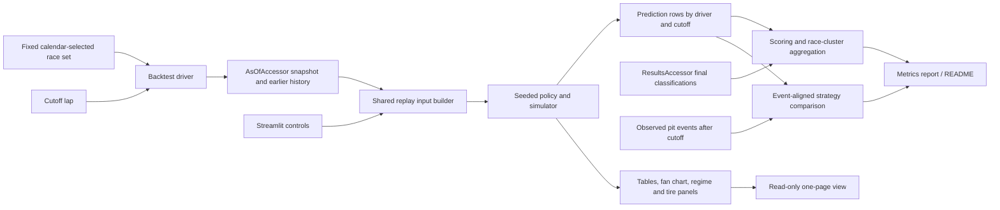

# Phase 6: MVP Backtest, Streamlit View & README - Research

**Researched:** 2026-11-13  
**Domain:** Walk-forward evaluation of stochastic race strategy, Streamlit dashboard  
**Confidence:** MEDIUM

<user_constraints>
## User Constraints (from CONTEXT.md)

### Locked Decisions

#### Race selection and aggregation
- **D-01:** Before scoring, pre-register ten complete races from 2023–2025, spread across years (4/3/3 when the catalog supports it) and selected using calendar order, season, round, and data completeness only. Include Bahrain 2023 as the fixed reference race. Do not select or replace races based on their outcomes or model metrics.
- **D-02:** Evaluate eligible as-of cutoffs in chronological order, using only earlier completed in-sample history. Average observations within each race, weight the ten races equally, and form uncertainty intervals by resampling whole races so repeated laps and drivers do not act like independent races.

#### Probability scores and uncertainty coverage
- **D-03:** Report Brier scores for podium and top-10 outcomes beside a probabilistic grid-position baseline learned only from earlier races. Use a conservative neutral prior when the first evaluation race has no usable earlier results. Report the model and baseline on the same drivers and cutoffs.
- **D-04:** Build each driver's 90% finishing-position interval from the central empirical interval of simulated outcomes at that cutoff. Report observed coverage with race-clustered uncertainty; do not tune the interval on the ten evaluation races.
- **D-05:** Measure Phase 4's real-data wear-band follow-up as a retrospective diagnostic against a leave-current-stint-out reference. Label this as a proxy rather than latent ground truth, report early-fit bias and own-laps double-counting evidence, and do not change the filter merely to make this diagnostic look better.

#### Platform recommendations and observed team stops
- **D-06:** Pair each recommendation with the next observed pit event using the decision available before that event. Report top-action agreement and stop-timing error per race with 95% race-cluster bootstrap intervals. Describe this as comparison with observed team behavior, not proof that the platform beats teams.

#### Streamlit page and defaults
- **D-07:** Build one read-only page with the required strategy table, finishing-position fan chart, regime gauge, tire estimate and uncertainty panel, reason line, and risk dial. Provide race, driver, cutoff-lap, and risk controls. Default to Bahrain 2023, ALO, a middle eligible cutoff, and risk aversion 0.5.
- **D-08:** Reuse cutoff-safe replay inputs and show the existing safety-car probability as the regime view; do not imply that Phase 8's Markov regime model exists. Clearly label prior-driven or sparse-fallback output as uncalibrated. Add Streamlit as a project dependency as required by the roadmap, without adding deployment or live streaming.

### the agent's Discretion
- The exact ten race IDs within the pre-registered season/round rule, with Bahrain 2023 fixed and the full list recorded before scoring.
- The smoothing details for the past-only grid baseline, the bootstrap implementation, app module layout, caching, and chart styling, provided the decisions above and existing data-access boundaries remain intact.

### Deferred Ideas (OUT OF SCOPE)
- 20-race per-era evaluation and the one-time 2026 holdout — Phase 8.
- Hierarchical Bayesian pace model — Phase 7.
- Markov regime model and regime-dependent pit loss — Phase 8.
- Live OpenF1 streaming, production deployment, market-odds benchmarking, and a broader dashboard — later milestones or out of scope.
</user_constraints>

<phase_requirements>
## Phase Requirements

| ID | Description | Research Support |
|----|-------------|------------------|
| BKT-01 | A walk-forward backtester runs races from 2023–2025 with zero look-ahead | Use the existing `AsOfAccessor`, earlier-race `History`, replay builder pattern, results boundary and future-scramble consumer guard. |
| BKT-02 | Backtest reports Brier score (podium, top-10) vs a grid-position baseline and 90% finishing-interval coverage | Store model/baseline probabilities on identical driver-cutoff rows; score and report per race before equal-race aggregation; central empirical simulated intervals. |
| BKT-04 | Strategy calls are compared with actual team calls, with confidence intervals | Align each recommendation with the next actual pit event strictly after its information cutoff; summarize agreement/timing error and resample whole races. |
| UI-01 | One-page Streamlit view shows strategy table, finishing-position fan chart, regime gauge, tire panel, reason line and risk dial | Reuse the cutoff-safe replay construction and existing plot/data patterns; controls and defaults are locked in D-07. |
| UI-02 | README documents real measured results, hidden-variable assumptions and data licensing/credits | Run and record the fixed evaluation before documenting results; explicitly state limitations and retain the existing OpenF1/Jolpica credit and non-redistribution conventions. |
</phase_requirements>

## Summary

Phase 6 is primarily an evaluation-integrity task. The repo already has a strict split between cutoff-visible observations, strictly earlier race history, final in-sample outcomes, and locked 2026 data. Keep the backtest driver as the only new orchestration layer: it should build fresh inputs at each cutoff, then pass plain snapshot/history-derived state to model code. Final classifications belong in `f1si.backtest.scoring`; no recommendation builder or Streamlit module should import the results or out-of-sample doors. [VERIFIED: `src/f1si/data/asof.py:1-15`, `src/f1si/data/results.py:1-8`, `tests/guards/import_scan.py:69-102`]

Use a frozen, calendar-selected ten-race set and preserve all driver/cutoff observations long enough to compute paired scores and event-level comparisons. Reduce observations within a race first, then give each race equal weight and form race-cluster bootstrap intervals. Probability estimates, interval coverage, and team-call agreement answer different questions and should remain separate in report tables. The existing Phase 3 ALO interval miss and Phase 4 wear-prior limitations are required diagnostics, not tuning targets. [CITED: `.planning/phases/06-mvp-backtest-streamlit-view-readme/06-CONTEXT.md`; `.planning/phases/03-monte-carlo-simulator/03-VERIFICATION.md`; `.planning/phases/04-kalman-tire-filter/04-HUMAN-UAT.md`]

For the dashboard, use Streamlit's native widgets and cache expensive deterministic replay/simulation work by its full input key. Streamlit reruns an app script on widget interaction, and its docs recommend caching expensive work or batching inputs in a form. There is no need to add a separate chart package solely for this page: the repo already renders Matplotlib `Figure` objects without `pyplot`, and Streamlit provides `st.pyplot`. [CITED: https://docs.streamlit.io/develop/concepts/design/performance; https://docs.streamlit.io/develop/api-reference/caching-and-state/st.cache_data; https://docs.streamlit.io/develop/api-reference/charts/st.pyplot; `src/f1si/plots/simulate.py:1-17`]

**Primary recommendation:** Implement a `f1si.backtest` walk-forward driver plus a scoring-only results module, keep app code thin over shared replay construction, pre-register the calendar set before scoring, and publish results only after race-clustered evaluation and look-ahead checks.

**Calendar-only ten-race recommendation:** Bahrain, Saudi Arabian, Australian and Azerbaijan 2023; Bahrain, Saudi Arabian and Australian 2024; Australian, Chinese and Japanese 2025. This is the first 4/3/3 calendar-round set with Bahrain 2023 included. The local catalog currently marks all 70 2023–2025 races complete; freeze these ten IDs and verify completeness before scoring. `[VERIFIED: environment probe — `uv run f1si races`, 2026-11-13; ASSUMED: use first calendar rounds as the discretion recommendation]`

## Architectural Responsibility Map

| Capability | Primary Tier | Secondary Tier | Rationale |
|------------|-------------|----------------|-----------|
| Walk-forward input construction | API / Backend | Database / Storage | A backtest driver owns cutoff iteration and uses the as-of/history door; storage access stays behind existing accessors. |
| Final-outcome scoring | API / Backend | Database / Storage | The dedicated scoring boundary may read final classifications; model/replay code cannot. |
| Probability and strategy evaluation | API / Backend | — | Metrics and race-cluster resampling are deterministic evaluation logic, not UI behavior. |
| Interactive replay view | Browser / Client | API / Backend | Streamlit renders controls/figures, while shared backend code constructs cutoff-safe rows and simulation output. |
| Results, assumptions and provenance | Documentation | — | README presents fixed measured outputs and explicit data/model limitations. |

## Standard Stack

### Core

| Library | Version | Purpose | Why Standard |
|---------|---------|---------|--------------|
| Python | 3.12 | Existing runtime | Project metadata constrains the interpreter to `>=3.12,<3.13`. `[VERIFIED: pyproject.toml:6]` Exact line: `requires-python = ">=3.12,<3.13"`. |
| NumPy | Existing range `>=2.3,<3` | Seeded simulations, quantiles, bootstrap sampling | Already used by simulator and `f1si.rng`; no new numerical dependency is needed for race-cluster bootstrap. `[VERIFIED: pyproject.toml:7-10]` Exact lines: `"numpy>=2.3,<3"`, `"pandas>=2.3.3,<3"`. |
| pandas | Existing range `>=2.3.3,<3` | Race/cutoff/metric tables | Matches existing snapshot and result accessors. `[VERIFIED: pyproject.toml:7-10]` |
| Streamlit | Current PyPI version observed: `1.67.0` (uploaded 2026-11-05) | One-page read-only UI | Official API docs cover widgets, charts and caching. The automated legitimacy seam initially rated the package **SUS** for “too-new” and “unknown-downloads”; official PyPI, repository, and release evidence resolved this as a metadata-heuristic false positive, so no separate checkpoint is required. See [Orchestrator Follow-up](#orchestrator-follow-up). `[CITED: https://docs.streamlit.io/; https://pypi.org/project/streamlit/; https://github.com/streamlit/streamlit; https://github.com/streamlit/streamlit/releases/tag/1.67.0]` |

### Supporting

| Library | Version | Purpose | When to Use |
|---------|---------|---------|-------------|
| Matplotlib | Existing range `>=3.11,<4` | Render the required fan chart from the project's existing Figure-based helpers | Reuse the plot primitives; use Streamlit `st.pyplot` to display them. `[VERIFIED: pyproject.toml:11-14]` |
| DuckDB | Existing range `>=1.5.6,<2` | Local cached race data, accessed only through doors | Do not query DuckDB from backtest/UI modules. `[VERIFIED: pyproject.toml:11-14; tests/guards/import_scan.py:69-102]` |

### Alternatives Considered

| Instead of | Could Use | Tradeoff |
|------------|-----------|----------|
| Streamlit native charts and existing Matplotlib figures | Add Plotly/Altair explicitly | A new plotting dependency adds package/audit and lockfile work; no existing requirement needs it. Streamlit docs recommend native/Vega charts for ordinary 2D plots, while existing project plot functions are Matplotlib. `[CITED: https://docs.streamlit.io/develop/concepts/design/charts]` |
| In-memory NumPy race-cluster resampling | Add a bootstrap/statistics package | Metrics here require resampling ten whole race clusters; NumPy is sufficient and already installed. Keep the algorithm small, seeded, and explicit. `[ASSUMED]` |

**Installation:**

```powershell
uv add "streamlit>=1.67,<2"
```

The official-source package review and user authorization are recorded in [Orchestrator Follow-up](#orchestrator-follow-up); the initial `SUS` metadata heuristic was a false positive, so no separate human checkpoint is required. Keep the dependency within the authorized version bound and update `uv.lock`. No deployment or streaming extras are in scope. [CITED: https://pypi.org/project/streamlit/; https://github.com/streamlit/streamlit; https://github.com/streamlit/streamlit/releases/tag/1.67.0; `.planning/ROADMAP.md` Phase 6]

**Version verification:** `https://pypi.org/pypi/streamlit/json` reported `1.67.0`, uploaded `2026-11-05T19:53:51.688727Z`, with declared `Requires-Python: >=3.11`. The project targets Python 3.12. The automated package gate initially flagged the release metadata, while the official package, repository, license, and matching release evidence in [Orchestrator Follow-up](#orchestrator-follow-up) confirms legitimacy. Streamlit is not installed in the current project environment (`uv run python -m streamlit --version` reports no module). [CITED: https://pypi.org/project/streamlit/; https://github.com/streamlit/streamlit; https://github.com/streamlit/streamlit/releases/tag/1.67.0; environment probe 2026-11-13]

## Package Legitimacy Audit

| Package | Registry | Age | Downloads | Source Repo | Verdict | Disposition |
|---------|----------|-----|-----------|-------------|---------|-------------|
| `streamlit` | PyPI | 8 days since latest upload observed | Unknown from gate | Official metadata links homepage `streamlit.io`, official GitHub source/release and Apache-2.0 license verified | Cleared by official-source review (initial `SUS` was a metadata-heuristic false positive) | Roadmap-required and user-authorized `streamlit>=1.67,<2`; no separate human checkpoint. |

**Packages removed due to [SLOP] verdict:** none  
**Initial automated [SUS] flag:** `streamlit` — resolved by the official-source review recorded in [Orchestrator Follow-up](#orchestrator-follow-up); no separate checkpoint is required.

The package-legitimacy seam initially returned `SUS` based on release age and unavailable download statistics. Official PyPI, repository, Apache-2.0 license, and matching release evidence resolves the warning as a metadata-heuristic false positive. The user authorized the recommended choice and the roadmap locks Streamlit, so install the bounded dependency without a separate checkpoint. See [Orchestrator Follow-up](#orchestrator-follow-up). [CITED: https://docs.streamlit.io/; https://pypi.org/project/streamlit/; https://github.com/streamlit/streamlit; https://github.com/streamlit/streamlit/releases/tag/1.67.0]

## Architecture Patterns

### System Architecture Diagram



**Data-flow contract:** The policy sees a cutoff-built `RaceState`; only the scoring layer sees final results. The locked 2026 door stays outside this phase. The context states `AsOfAccessor` supplies current snapshots and strictly earlier in-sample history, while results access is reserved for `f1si.backtest.scoring`. `[CITED: .planning/phases/06-mvp-backtest-streamlit-view-readme/06-CONTEXT.md; VERIFIED: src/f1si/data/asof.py:1-15]`

### Recommended Project Structure

```text
src/f1si/
├── backtest/
│   ├── __init__.py
│   ├── walk_forward.py   # pre-registered races and cutoff orchestration
│   ├── scoring.py        # only module that imports f1si.data.results
│   ├── metrics.py        # proper scores, interval coverage, race bootstrap
│   └── strategy.py       # event-aligned comparison with observed stops
└── app.py                # one read-only Streamlit page; thin shared-service caller
```

These are suggested responsibilities, not locked file paths. Preserve the import-policy boundary that allows `f1si.data.results` only to `f1si.backtest.scoring`; add app code without giving it an accessor or direct SQL capability. `[VERIFIED: tests/guards/import_scan.py:65-102; ASSUMED: suggested module layout]`

### Pattern 1: Cutoff-local replay and score separation

**What:** For each pre-registered race and each eligible cutoff in ascending order, obtain a fresh snapshot and history from `AsOfAccessor`, construct replay inputs from those objects, and save prediction output before opening final outcomes. The scoring module joins predictions to final results after inference. **When to use:** Every walk-forward prediction and the dashboard's selected cutoff. [VERIFIED: `src/f1si/data/asof.py:82-117`; `src/f1si/cli.py:949-1015`]

**Example:**

```python
at = AsOf(race_id, cutoff_lap)
snapshot = accessor.snapshot(at)
history = accessor.history(at)
prediction = build_prediction(snapshot, history, driver=driver_code, seed=seed)
# Only scoring.py calls ResultsAccessor.final_classification after prediction is frozen.
```

`AsOf` and the method names are quoted directly from the opened definitions: `class AsOfAccessor`, `def snapshot(self, at: AsOf)`, and `def history(self, at: AsOf)`. `[VERIFIED: src/f1si/data/asof.py:82-117]` The `ResultsAccessor` contract is `def final_classification(self, race_id: str) -> pd.DataFrame`; its module docstring restricts use to `f1si.backtest.scoring`. `[VERIFIED: src/f1si/data/results.py:1-42]`

### Pattern 2: Paired, race-clustered metrics

**What:** Store one row per race/driver/cutoff with predicted podium/top-10 probabilities, simulated finish quantiles, actual result, baseline probabilities, fallback status, seed, and observed-stop linkage where available. Compute per-row Brier losses and interval hits, average within race, then average the ten race values equally. Resample race IDs with replacement and carry every row from each sampled race together; use paired resamples for model-minus-baseline differences. **When to use:** Brier score comparisons, finish-interval coverage uncertainty, and BKT-04 confidence intervals. The weighting and whole-race resampling are locked. [CITED: 06-CONTEXT.md D-02–D-06]

**Recommendation:** Use NumPy's injected generator for deterministic bootstrap replicate selection; persist the bootstrap seed and replicate count with the report. Keep the confidence level explicitly 95% for strategy agreement/timing per D-06; use the interval level agreed for other metrics in the plan and label it. `[ASSUMED]`

### Pattern 3: Event-aligned stop comparison

**What:** For each driver's actual pit event, select the latest eligible prediction whose cutoff precedes the event and for which that event was not yet visible; compare the recommended top action and its first planned stop lap with the observed event. Avoid treating every preceding lap as a separate independent observed team decision. Aggregate agreement and signed/absolute timing error per race, then cluster-bootstrap races. **When to use:** BKT-04. This makes the “decision available before that event” rule operational while retaining the context's event alignment. `[CITED: 06-CONTEXT.md D-06; ASSUMED: latest eligible preceding cutoff tie rule]`

### Pattern 4: Cache expensive UI work at the true input boundary

**What:** Keep Streamlit widgets at the page boundary. Cache deterministic replay results only when the cache key contains race, driver, cutoff, risk, simulation count, seed, data path and any model/config version used by construction. Streamlit reruns the script from top to bottom on widget interactions; its docs recommend caching expensive work or using forms to batch controls. **When to use:** The page's replay/simulation computation, not mutable accessor objects or a shared database connection. [CITED: https://docs.streamlit.io/develop/concepts/design/performance; https://docs.streamlit.io/develop/api-reference/caching-and-state/st.cache_data]

For ordinary charting, use Streamlit-native chart elements or the existing Matplotlib figure helpers and `st.pyplot`; if selecting a gauge implementation, verify the supported chart element at implementation time. Do not add Plotly solely for a gauge without package review. [CITED: https://docs.streamlit.io/develop/api-reference/charts; https://docs.streamlit.io/develop/api-reference/charts/st.pyplot]

### Anti-Patterns to Avoid

- **Fit once at race end, then replay historical cutoffs:** this leaks later laps into early predictions. Rebuild fit, wear, safety-car estimate and state from the selected snapshot/history at every cutoff. [VERIFIED: `src/f1si/cli.py:949-1015`; `DECISIONS.md` DEC-095]
- **Import final results into model or UI code:** only `f1si.backtest.scoring` may import `f1si.data.results`. [VERIFIED: `tests/guards/import_scan.py:91-102`]
- **Select/replace races after seeing their metrics:** violates the locked calendar-only pre-registration. [CITED: `06-CONTEXT.md` D-01]
- **Treat drivers, cutoffs or laps as independent bootstrap samples:** they are clustered inside only ten races. Resample whole races. [CITED: `06-CONTEXT.md` D-02, D-06]
- **Call team agreement evidence that the model beats teams:** the locked interpretation is comparison with observed behavior only. [CITED: `06-CONTEXT.md` D-06]
- **Render a generic green/SC/VSC/wet probability gauge:** Phase 6 only has the existing safety-car probability estimate; Markov regimes are Phase 8. [CITED: `06-CONTEXT.md` D-08]
- **Claim calibrated output for sparse fallback or prior-driven results:** Phase 5 explicitly marks sparse fallback uncalibrated and uses an assumed 1.0 s offset SD. [VERIFIED: `DECISIONS.md` DEC-101; `src/f1si/cli.py:988-1015`]
- **Recompute 50,000-path simulation on every widget keystroke:** Streamlit reruns scripts; use caching or form submission. [CITED: https://docs.streamlit.io/develop/concepts/design/performance]

## Don't Hand-Roll

| Problem | Don't Build | Use Instead | Why |
|---------|-------------|-------------|-----|
| Race cutoff visibility/history | Direct SQL, custom visibility filtering, or end-of-race snapshots | `AsOfAccessor.snapshot` and `.history` | The door rebuilds current race fields from visible data and returns only earlier completed history. `[VERIFIED: src/f1si/data/asof.py:1-15; src/f1si/data/_snapshot.py:1-28]` |
| Final outcome access | A second query path or direct DuckDB access from callers | `ResultsAccessor` inside `f1si.backtest.scoring` | Preserves the import and data door contract. `[VERIFIED: src/f1si/data/results.py:1-42; tests/guards/import_scan.py:91-102]` |
| Replay input assembly | Separate dashboard-only as-of builder | Factor/use shared cutoff construction based on `src/f1si/cli.py::_replay_at_cutoff` | Selected and full replay already share cutoff-safe construction; context requires the page to reuse it. `[VERIFIED: src/f1si/cli.py:949-1015; CITED: 06-CONTEXT.md]` |
| Seed creation | Local calls to global NumPy RNG constructors | `f1si.rng.make_rng` and injected `np.random.Generator` | FND-03 and import guard preserve reproducibility. `[VERIFIED: tests/guards/import_scan.py:27-56; .planning/REQUIREMENTS.md FND-03]` |
| Basic 2D charting | New visualization dependency | Streamlit built-in chart commands or existing Matplotlib figures | Required page has no special chart dependency requirement. `[CITED: https://docs.streamlit.io/develop/concepts/design/charts]` |

**Key insight:** The most dangerous implementation errors are silent leakage and pseudo-replication, not the Brier formula. Preserve the separate doors and race as the unit of aggregation/uncertainty. `[CITED: 06-CONTEXT.md D-02, D-03, D-06]`

## Common Pitfalls

### Pitfall 1: A walk-forward name with hindsight inside each cutoff

**What goes wrong:** Earlier recommendations incorporate same-race future laps, a same-race final outcome, or later races.  
**Why it happens:** The full-race fit is easy to reuse and the final results table is readily available.  
**How to avoid:** Rebuild every input from `snapshot(AsOf(race, lap))` plus `history(AsOf(race, lap))`; only score frozen output later. Register each new as-of consumer with the future-scramble test.  
**Warning signs:** Changing future rows changes a prior cutoff prediction, or results access appears outside `f1si.backtest.scoring`. `[VERIFIED: src/f1si/data/asof.py:82-117; tests/guards/consumers.py:1-28; tests/guards/import_scan.py:91-102]`

### Pitfall 2: Baseline sees the target race or future outcomes

**What goes wrong:** Grid-position probabilities are deceptively strong because the target race's outcomes were used to estimate them.  
**Why it happens:** A convenient global table groups all results by grid position.  
**How to avoid:** Fit baseline rates using only prior completed in-sample races at the target's calendar point; freeze it before evaluating the current event. Reuse identical driver/cutoff rows for model and baseline.  
**Warning signs:** First race has a non-neutral empirical rate despite no earlier outcomes, or baseline changes when a later race result is scrambled. `[CITED: 06-CONTEXT.md D-02, D-03]`

### Pitfall 3: Mis-handling discrete positions and retirements

**What goes wrong:** Podium/top-10 labels, quantiles or observed coverage differ silently for unclassified drivers or integer interval endpoints.  
**Why it happens:** Final-position and classified-position fields are both available; discrete empirical intervals need an explicit quantile convention.  
**How to avoid:** Decide and document: which final-position field defines finish rank, whether null/unclassified outcomes count as non-podium/non-top-10, and how inclusive integer endpoints are computed. Keep those semantics fixed in scoring and tests. `[VERIFIED: src/f1si/data/results.py:17-41; ASSUMED: scoring convention requires explicit choice]`

### Pitfall 4: Treating many cutoffs as many independent races

**What goes wrong:** Confidence intervals become far too narrow.  
**Why it happens:** Ten races generate hundreds of correlated driver/cutoff rows.  
**How to avoid:** Reduce within race and bootstrap the ten race clusters; pair model and baseline inside each sampled race.  
**Warning signs:** Bootstrap samples individual rows or drivers. `[CITED: 06-CONTEXT.md D-02, D-06]`

### Pitfall 5: Wear diagnostic becomes tuning by hindsight

**What goes wrong:** A retrospective wear proxy is presented as true hidden tire wear, or its method is modified until the ten races look good.  
**Why it happens:** Fuel and wear are hidden and early field-fit priors can be biased.  
**How to avoid:** Compare filter estimates with the leave-current-stint-out retrospective reference and label it a proxy. Report early-fit bias and own-laps share/double-counting evidence separately; do not update the filter in this phase. DEC-091 reports Bahrain ALO current-stint laps are included in the field prior (e.g., 12 of 193 clean SOFT laps at lap 14), and the Phase 4 UAT accepted early band weakness for Phase 6 measurement. `[VERIFIED: DECISIONS.md DEC-091; .planning/phases/04-kalman-tire-filter/04-HUMAN-UAT.md]`

### Pitfall 6: Streamlit UI repeatedly performs long work

**What goes wrong:** Changing a slider launches the entire simulation again, making the page appear stuck.  
**Why it happens:** Streamlit executes the app from the top after widget interaction.  
**How to avoid:** Cache deterministic results keyed by all replay inputs, or wrap the controls in a form and compute on submit. Keep only one selected-cutoff simulation live; load the fixed backtest summary separately.  
**Warning signs:** Unchanged inputs rerun policy work or cache identity omits risk, seed, path, or data/config identity. `[CITED: https://docs.streamlit.io/develop/concepts/design/performance; https://docs.streamlit.io/develop/api-reference/caching-and-state/st.cache_data]`

## Code Examples

### Official Streamlit pattern: controls and cached function

```python
import streamlit as st

race = st.selectbox("Race", race_options, index=default_race_index)
driver = st.selectbox("Driver", driver_options, index=default_driver_index)
cutoff = st.slider("Cutoff lap", min_value=0, max_value=max_lap, value=middle_cutoff)
risk = st.slider("Risk aversion", min_value=0.0, max_value=1.0, value=0.5)

@st.cache_data
def replay_view(data_path: str, race: str, driver: str, cutoff: int, risk: float):
    return build_cutoff_view(data_path, race, driver, cutoff, risk)
```

Official docs cover `st.selectbox`, `st.slider`, and `st.cache_data`; extend the cache key with simulation seed/count and a data/model identity if those affect returned values. The defaults shown follow D-07, but use the actual middle eligible cutoff from the registered race. The existing replay CLI states the locked risk bounds/default verbatim: `risk aversion in [0, 1]: 0 weights mean, 1 weights worst-decile CVaR (default 0.5)`. `[VERIFIED: src/f1si/cli.py:238-247]` `[CITED: https://docs.streamlit.io/develop/api-reference/widgets/st.selectbox; https://docs.streamlit.io/develop/api-reference/widgets/st.slider; https://docs.streamlit.io/develop/api-reference/caching-and-state/st.cache_data; .planning/phases/06-mvp-backtest-streamlit-view-readme/06-CONTEXT.md D-07]`

### Race-cluster bootstrap skeleton

```python
def bootstrap_race_means(by_race, *, n_resamples: int, rng):
    race_ids = tuple(by_race)
    estimates = np.empty(n_resamples)
    for b in range(n_resamples):
        sampled = rng.choice(race_ids, size=len(race_ids), replace=True)
        estimates[b] = np.mean([by_race[race_id] for race_id in sampled])
    return estimates
```

Treat `by_race[race_id]` as that race's already-aggregated metric, not each driver's/lap's raw loss. Inject the repo RNG; this skeleton is an implementation sketch based on the locked method, not copied official-source code. `[CITED: 06-CONTEXT.md D-02, D-06; ASSUMED: sketch]`

## State of the Art

| Old Approach | Current Approach | When Changed | Impact |
|--------------|------------------|--------------|--------|
| Fit one end-of-race model and call its rows a replay | Rebuild at each as-of cutoff, including pace fit, wear and safety-car history | Phase 5 DEC-095/100 | Prevents later laps from affecting earlier recommendations; more computation. `[VERIFIED: DECISIONS.md DEC-095, DEC-100]` |
| Use only identified fits and omit sparse cutoffs | Phase 5 includes an explicit prior-driven sparse fallback and labels it uncalibrated | Phase 5 Plan 04 / DEC-101 | The dashboard can show every cutoff but must disclose its basis. `[VERIFIED: DECISIONS.md DEC-101]` |
| Treat simulated 90% intervals as calibrated without real outcomes | Measure empirical coverage across races and carry the ALO P3 miss | Phase 3 verification and Phase 6 scope | Report misses/uncertainty; do not tune on the evaluation set. `[CITED: 03-VERIFICATION.md; 06-CONTEXT.md D-04]` |

**Deprecated/outdated:** No external framework deprecation is needed for this phase. Avoid Streamlit's deprecated `use_container_width` argument for Plotly charts; if Plotly is later justified, current docs use `width="stretch"`. Plotly itself is not recommended here. `[CITED: https://docs.streamlit.io/develop/api-reference/charts/st.plotly_chart]`

## Assumptions Log

| # | Claim | Section | Risk if Wrong |
|---|-------|---------|---------------|
| A1 | Choose the first four 2023 rounds, first three 2024 rounds and first three 2025 rounds by calendar order, yielding Bahrain 2023 plus nine calendar-first races; verify completeness and freeze IDs before any scoring. | Architecture / race registration | If round completeness differs in the evaluation cache, selection must be resolved before scoring without outcome inspection. |
| A2 | Use paired race-level bootstrap replicates and a persisted RNG seed/count. | Architecture patterns | Different resampling or interval convention changes uncertainty width and reproducibility. |
| A3 | For team-call alignment, use the latest eligible recommendation before each observed stop, with that stop not yet visible. | Architecture patterns | A different operational event/cutoff matching rule changes agreement/timing metrics. |
| A4 | Decide explicit null-position, podium/top-10, discrete quantile and coverage inclusion semantics before implementation. | Pitfalls | Ambiguous result handling invalidates proper-score and coverage comparisons. |
| A5 | The automated Streamlit legitimacy check initially returned SUS; official-source review cleared it as a metadata-heuristic false positive, and no separate checkpoint is required. | Stack / package audit / Orchestrator Follow-up | The dependency remains bounded to `streamlit>=1.67,<2` and authorized by the roadmap and user. |
| A6 | A computed one-page dashboard can use Matplotlib and Streamlit native APIs without adding a chart package. | Standard stack | A later confirmed chart requirement may justify another dependency and its audit. |

## Open Questions

1. **RESOLVED — What exactly defines an eligible cutoff and scored outcome?**
   - Evaluate every eligible cutoff from lap 0 through each race's final strategy-eligible cutoff. Freeze the prediction-only full sample before any final-results access.
   - Count unclassified starters as non-podium and non-top-10 for binary scores. Compute finishing-interval coverage only for classified finishers and report the classified-finisher denominator.
   - Use inclusive empirical 5th/95th endpoints with `method="inverted_cdf"` for the central 90% finishing-position interval.
   - Decision record: [Orchestrator Follow-up — scoring semantics selected for the plan](#orchestrator-follow-up).

2. **RESOLVED — What neutral prior should initialize the first grid baseline?**
   - Use the neutral event-rate prior: podium `3 / field_size`; top-10 `min(10, field_size) / field_size`.
   - Shrink sparse grid-position estimates toward those rates with five pseudo-observations, updating only from earlier completed races.
   - Decision record: [Orchestrator Follow-up — scoring semantics selected for the plan](#orchestrator-follow-up).

3. **RESOLVED — What confidence level should accompany Brier and interval-coverage uncertainty?**
   - Use 95% race-cluster bootstrap intervals for Brier, interval coverage, and team-call summaries, including paired model-minus-baseline Brier intervals.
   - Decision record: [Orchestrator Follow-up — scoring semantics selected for the plan](#orchestrator-follow-up).

4. **RESOLVED — Should the package legitimacy warning be cleared before adding Streamlit?**
   - Official [PyPI project evidence](https://pypi.org/project/streamlit/), the [Streamlit repository](https://github.com/streamlit/streamlit), its [Apache-2.0 license](https://github.com/streamlit/streamlit/blob/develop/LICENSE), and the matching [1.67.0 release](https://github.com/streamlit/streamlit/releases/tag/1.67.0) confirm the legitimate Streamlit project and provenance. The local `SUS` result was a metadata-heuristic false positive, consistent with the Phase 3 Numba precedent in `.planning/phases/03-monte-carlo-simulator/03-01-PLAN.md`.
   - Use the roadmap-required, user-authorized `streamlit>=1.67,<2` dependency without a separate checkpoint.
   - Decision record: [Orchestrator Follow-up — package legitimacy review](#orchestrator-follow-up).

## Environment Availability

| Dependency | Required By | Available | Version | Fallback |
|------------|------------|-----------|---------|----------|
| uv | Python dependency and project commands | ✓ | 0.13.5 | — |
| CPython | Runtime | ✓ | 3.12.10 via `uv run python` | — |
| Local DuckDB race cache | Backtest and app data | ✓ | 87 completed catalog entries: 70 in-sample 2023–2025 and 17 locked 2026 | — |
| Streamlit | UI-01 | ✗ (not installed in project venv) | Candidate 1.67.0, installation authorized after official-source review | Add the bounded dependency per roadmap; no UI framework fallback because requirement names Streamlit |

The cache catalog command showed all 70 2023–2025 races as loaded and 17 2026 races as locked. Recheck selected-race completeness from the target cache before pre-registration/scoring. `uv run f1si races` was available; `uv run python -m streamlit --version` found no Streamlit module. `[VERIFIED: environment probes 2026-11-13]`

**Missing dependencies with no fallback:** Streamlit until the authorized bounded dependency is added; this blocks the UI run but not backtest research. The package review is resolved and no separate checkpoint is required.

**Missing dependencies with fallback:** none.

## Validation Architecture

### Test Framework

| Property | Value |
|----------|-------|
| Framework | pytest 9.x from project dependency range; Hypothesis is already configured for property tests |
| Config file | `[tool.pytest]` in `pyproject.toml`; shared fixtures in `tests/conftest.py` |
| Quick run command | `uv run pytest tests/backtest -q` (create target tests with the package) |
| Full suite command | `uv run pytest` |

Existing tests use `tests/guards/test_future_scramble.py`, `tests/guards/test_consumer_registry.py`, and `tests/guards/test_import_ban.py` to protect as-of consumers and result-access boundaries. `[VERIFIED: tests/guards/consumers.py:1-28; tests/guards/import_scan.py:91-102; pyproject.toml:56-60]`

### Phase Requirements → Test Map

| Req ID | Behavior | Test Type | Automated Command | File Exists? |
|--------|----------|-----------|-------------------|-------------|
| BKT-01 | Ten fixed races and each cutoff prediction invariant under future-row scramble; 2026 remains excluded | integration/property | `uv run pytest tests/guards/test_future_scramble.py tests/backtest/test_walk_forward.py -q` | Existing guard; new backtest tests Wave 0 |
| BKT-02 | Brier calculations, past-only grid baseline, same observation mask, empirical 90% finish interval and race-level aggregation | unit/integration | `uv run pytest tests/backtest/test_metrics.py -q` | Wave 0 |
| BKT-04 | Actual stop mapping uses pre-event recommendation and cluster-bootstrap uncertainty is deterministic by seed | unit/integration | `uv run pytest tests/backtest/test_strategy.py -q` | Wave 0 |
| UI-01 | One page has required six displays and four controls/defaults; output labels fallback and SC proxy accurately | smoke/manual + unit | `uv run streamlit run src/f1si/app.py` plus page/service tests | Wave 0 |
| UI-02 | README includes measured report, hidden-variable limits and credits/licensing | docs regression | `uv run pytest tests/test_docs.py -q` | Existing docs test; extend for Phase 6 assertions |

### Sampling Rate

- **Per task commit:** `uv run pytest <focused changed tests> -q`
- **Per wave merge:** `uv run pytest`
- **Phase gate:** full pytest, ruff, format, strict mypy, and CI on the exact phase head before `$gsd-verify-work`, per `CLAUDE.md`.

### Wave 0 Gaps

- [ ] `tests/backtest/test_walk_forward.py` — registered race list, ordered cutoffs, prior-only history, future-scramble equality, 2026 refusal.
- [ ] `tests/backtest/test_metrics.py` — Brier, baseline past-only boundary, interval endpoint semantics, per-race weighting, paired cluster bootstrap.
- [ ] `tests/backtest/test_strategy.py` — event matching, no same-event look-ahead, timing error and deterministic race resampling.
- [ ] `tests/app/` — page composition and fallback/safety-car/tire labels without requiring a live browser for math-level behavior.
- [ ] Register the backtest public consumer(s) in `tests/guards/consumers.py`; confirm `tests/guards/import_scan.py` permits final results only from `f1si.backtest.scoring`.

## Security Domain

> Security enforcement is enabled because `.planning/config.json` has no explicit `security_enforcement: false`.

### Applicable ASVS Categories

| ASVS Category | Applies | Standard Control |
|---------------|---------|-----------------|
| V2 Authentication | no | Local read-only single-user page; no authentication requirement in locked scope. `[CITED: 06-CONTEXT.md D-07/D-08]` |
| V3 Session Management | yes (framework-managed) | Use Streamlit's normal per-browser-tab session lifecycle; no custom authentication/session-token layer is required by this read-only local page. `[CITED: https://docs.streamlit.io/develop/concepts/architecture/session-state; 06-CONTEXT.md D-08]` |
| V4 Access Control | yes | Keep UI read-only; no raw results door or arbitrary data path in page code; server-side module import guard enforces data boundaries. `[VERIFIED: tests/guards/import_scan.py:69-102]` |
| V5 Validation, Sanitization and Encoding | yes | Restrict race/driver/cutoff/risk to catalog-backed options and finite bounds; existing replay validates these inputs. `[VERIFIED: src/f1si/cli.py:214-247; 1062-1118; CITED: https://devguide.owasp.org/en/03-requirements/05-asvs/]` |
| V6 Stored Cryptography | no | No credentials, secrets, or cryptographic operations are required for this local read-only phase. `[CITED: 06-CONTEXT.md D-08; https://devguide.owasp.org/en/03-requirements/05-asvs/]` |

### Known Threat Patterns for Python / Streamlit

| Pattern | STRIDE | Standard Mitigation |
|---------|--------|---------------------|
| UI can accidentally expose future results through an import or direct DB read | Information disclosure | Keep `AsOfAccessor` in replay driver; keep `ResultsAccessor` in `f1si.backtest.scoring`; keep 2026 accessor locked outside Phase 8. `[VERIFIED: tests/guards/import_scan.py:69-102]` |
| User-controlled string used as file path/SQL identifier | Tampering | Select from catalog-backed values; use existing parameterized accessors; never interpolate values into SQL or output paths. `[VERIFIED: src/f1si/data/asof.py:67-79; src/f1si/data/results.py:17-21]` |
| Shared cached state leaks across users or changes | Information disclosure | Use `st.cache_data` for immutable results with complete keys; avoid caching open connection/accessor objects or mutable global state. `[CITED: https://docs.streamlit.io/develop/api-reference/caching-and-state/st.cache_data]` |

## Sources

### Primary (HIGH confidence)

- `src/f1si/data/asof.py`, `src/f1si/data/results.py`, `src/f1si/cli.py`, `src/f1si/strategy/longstaff.py`, `src/f1si/pace/kalman.py` — source-of-truth for cutoff, scoring, replay, policy and wear data boundaries.
- `tests/guards/import_scan.py`, `tests/guards/consumers.py`, `tests/guards/test_future_scramble.py` — project enforcement of import and look-ahead behavior.
- `.planning/phases/06-mvp-backtest-streamlit-view-readme/06-CONTEXT.md`, `.planning/REQUIREMENTS.md`, `.planning/ROADMAP.md`, `.planning/STATE.md`, `CLAUDE.md`, `DECISIONS.md` — product/phase locks and project instructions.
- `.planning/phases/03-monte-carlo-simulator/03-VERIFICATION.md`, `.planning/phases/04-kalman-tire-filter/04-HUMAN-UAT.md`, `.planning/phases/05-longstaff-schwartz-strategy-live-replay/05-03-SUMMARY.md`, `05-04-SUMMARY.md` — prior evaluation findings and reusable replay evidence.
- [OWASP ASVS category guide](https://devguide.owasp.org/en/03-requirements/05-asvs/) — current category names used for the security applicability map.

### Secondary (MEDIUM confidence)

- [Streamlit performance docs](https://docs.streamlit.io/develop/concepts/design/performance) — rerun and cache recommendations.
- [Streamlit `st.cache_data` reference](https://docs.streamlit.io/develop/api-reference/caching-and-state/st.cache_data), [widget references](https://docs.streamlit.io/develop/api-reference/widgets/st.selectbox), [chart references](https://docs.streamlit.io/develop/api-reference/charts) — current API behavior.
- [PyPI Streamlit metadata](https://pypi.org/project/streamlit/) — current published package version and metadata; legitimacy seam independently flagged SUS.

### Tertiary (LOW confidence)

- No low-confidence external claims retained as established facts. Explicit implementation assumptions are listed in the Assumptions Log.

## Metadata

**Confidence breakdown:**
- Standard stack: MEDIUM — repo/runtime and official Streamlit identity/release/license evidence verified; the app dependency is not installed yet.
- Architecture: HIGH — data doors, CLI builder and guard contracts read in source this session; race-level bootstrap choice follows locked context.
- Pitfalls: HIGH — grounded in source, locked decisions and documented prior Phase 3/4 findings.

**Research date:** 2026-11-13  
**Valid until:** 2026-12-13 (recheck Streamlit version/docs before installation)

## Orchestrator Follow-up

**Race set selected before scoring:** `2023-01` Bahrain, `2023-02` Saudi Arabian, `2023-03` Australian, `2023-04` Azerbaijan; `2024-01` Bahrain, `2024-02` Saudi Arabian, `2024-03` Australian; `2025-01` Australian, `2025-02` Chinese, `2025-03` Japanese. This is a 4/3/3 calendar-first sample and includes the fixed Bahrain reference race. The execution plan must confirm these ten IDs are complete in the target cache before running any scores and must not replace them based on outcomes.

**Package legitimacy review:** The local seam's `SUS` result is based on the new release date and unavailable download statistics. The official [PyPI project record](https://pypi.org/project/streamlit/) identifies the package as Streamlit, lists Apache-2.0 and Python >=3.11, and shows provenance for the 1.67.0 artifacts. The [official Streamlit repository](https://github.com/streamlit/streamlit) is public and Apache-2.0 licensed; its [1.67.0 release](https://github.com/streamlit/streamlit/releases/tag/1.67.0) matches the PyPI release date. This independently verifies the package identity and makes the heuristic a false positive, following the documented Numba name-similarity disposition in `.planning/phases/03-monte-carlo-simulator/03-01-PLAN.md`. The user authorized the agent to choose recommended options, and the roadmap explicitly requires Streamlit; plan a version-bounded `streamlit>=1.67,<2` dependency with `uv.lock` committed and CI using `uv sync --locked`, without a separate human checkpoint.

**Scoring semantics selected for the plan:** Score every eligible cutoff from lap 0 through the final strategy-eligible cutoff. Unclassified starters count as non-podium/non-top-10 for binary scores; report finishing-interval coverage only for drivers with a classified final position and publish that denominator because the simulator has no DNF model. Use inclusive discrete empirical 5th/95th percentile endpoints (`method="inverted_cdf"`) for the central 90% interval. Use 95% race-cluster bootstrap intervals for Brier, coverage, and team-call summaries, with paired model-minus-baseline Brier intervals. Initialize a grid-position baseline with a neutral event-rate prior (podium `3 / field_size`, top-10 `min(10, field_size) / field_size`) and shrink sparse grid-position estimates toward that rate using five prior observations; update only from earlier completed races.
