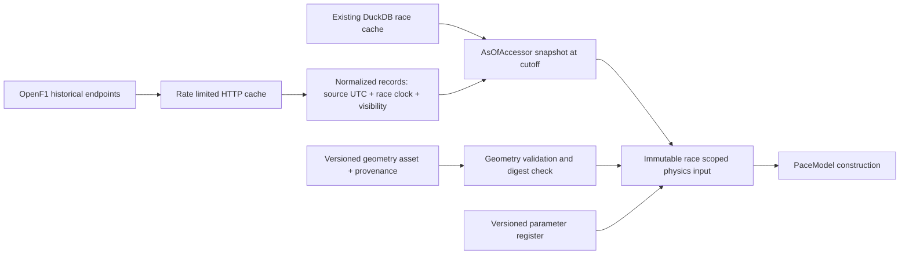

# Phase 9: Data and Geometry Readiness - Research

**Researched:** 2026-11-17  
**Domain:** Cutoff-safe telemetry ingestion, track geometry provenance, parameter identifiability  
**Confidence:** MEDIUM

<user_constraints>
## User Constraints (from CONTEXT.md)

### Locked Decisions
- **D-01:** Read optional OpenF1 telemetry, location, and weather only through the rate-limited cache and the as-of boundary. Preserve source timestamps and the mapping to the lights-out race clock; include a row only when it was visible at the requested cutoff.
- **D-02:** Keep optional channels optional. Report per-race and per-channel coverage and quality. If data are sparse, use the documented cached-lap fallback; never silently fabricate telemetry, interpolate across a cutoff, or treat approximate location as survey-grade geometry.
- **D-03:** Evaluate a versioned Sakhir/Bahrain 2023 profile as the reference candidate. Record its source, version or retrieval reference, coordinate frame and transform, units, quality checks, attribution, and SHA-256 digest.
- **D-04:** Bundle a geometry asset only after the specific file's redistribution terms are verified. If terms are unclear, keep it external/local and refer to it by digest and provenance; downstream model execution must fail clearly when the required asset is unavailable or fails quality checks.
- **D-05:** Fit and publish only effective parameter composites whose identifiability is supported by available evidence. Label absolute mass, power, aero, grip, fuel, and tire quantities as hidden assumptions unless independently identified.
- **D-06:** For assumed quantities, record cited evidence, season-specific bounds, uncertainty, and sensitivity. Treat regulatory minima as constraints, not measured team values; do not report team-specific hidden values as recovered parameters.
- **D-07:** Construct an immutable, race-scoped physics input before the simulation hot path. Model code receives prepared values and no cache accessor. Preserve the existing `PaceModel` signature and leave simulator, strategy, and backtest consumers unchanged.
- **D-08:** Extend the existing normalized source/cache and as-of design where required. Tests must prove cutoff safety and preserve original source time provenance; current-race results and the separate 2026 holdout remain inaccessible to M2 fitting.

### the agent's Discretion
- Choose concrete schemas, coverage summaries, geometry quality thresholds, candidate asset pinning mechanics, and fit diagnostics that satisfy the locked requirements and fail closed on missing or invalid inputs.
- Use OpenF1 only where observed coverage and timestamp alignment pass those documented quality checks. No new FastF1 downloads are required.

### Deferred Ideas (OUT OF SCOPE)
- Geometry coverage for every circuit belongs to a later requirement (PHY-03).
- Full vehicle dynamics, private telemetry reconstruction, and user-facing product work remain outside M2.
</user_constraints>

<phase_requirements>
## Phase Requirements

| ID | Description | Research Support |
|----|-------------|------------------|
| DAT-01 | A user can build a provenance-checked, cutoff-safe physics input from the existing cached race data and optional historical OpenF1 car telemetry, location, and weather, with unavailable coverage reported explicitly. | Extend the existing rate-limited OpenF1 source, normalized time schema, and `AsOfAccessor`; report per-race/channel availability and preserve UTC source timestamps alongside the race clock. |
| GEO-01 | A user can run the pace model on a versioned, unit-checked track profile with source, coordinate transform, quality checks, and redistribution terms recorded; Bahrain 2023 is the reference track. | Pin an asset revision and digest; validate format, units, closure, widths, curvature, and transform; keep it external/local unless file-level redistribution terms are confirmed. |
| PAR-01 | A user can inspect which vehicle, fuel, and tire quantities are fitted effective parameters versus assumed hidden values, including evidence, era-specific bounds, uncertainty, and sensitivity results. | Create a versioned parameter register that separates identifiable composites from assumptions and connects each assumption to evidence, bounds, uncertainty, and sensitivity. |
</phase_requirements>

## Summary

Build Phase 9 as a preparation layer around existing race snapshots: enrich the normalized cache with optional timestamped channels, produce a race-scoped immutable physics input from the as-of door, validate and pin one Sakhir profile, and publish a parameter/assumption register. Do not add a new runtime dependency or put cache reads inside the `PaceModel` hot path. The source tree already has a cutoff contract, rate-limited response cache, and stable pace protocol to extend. `[VERIFIED: src/f1si/data/_snapshot.py:6-14; src/f1si/data/sources/openf1.py:172-183; src/f1si/interfaces.py:149-165]`

The current local DuckDB contains 87 complete race records (70 in-sample 2023–2025 and 17 marked out-of-sample in 2026), 13,928 weather rows, and no `car_data`, `location`, or `telemetry` tables. This is a read-only audit of `data/f1si.duckdb`; do not use direct cache reads from model code. Existing normalized weather rows have race-clock `t_s` and no original UTC source timestamp, so retain a source timestamp for new time-indexed input and document how it maps to `t=0` at lights out. `[VERIFIED: local DuckDB data/f1si.duckdb, read-only table/count audit; src/f1si/data/schema.py:190-208]`

OpenF1 documents historical data from 2023 onward, telemetry/location sampling around 3.7 Hz, and weather fields including ambient and track temperature. Its location stream has an arbitrary origin and no lateral placement, so it can support progress alignment or diagnostics only after quality checks; it cannot stand in for track geometry. `[CITED: https://openf1.org/docs/]` The TUMFTM database is a viable Sakhir candidate, but variable source quality and asset-level licensing must be checked before bundling. `[CITED: https://github.com/TUMFTM/racetrack-database]`

**Primary recommendation:** Add optional telemetry/location as time-indexed normalized records through the existing cache, keep source UTC timestamp + race-clock time + cutoff visibility, and have a preparation builder return immutable values only. Pin the geometry candidate to an immutable retrieval reference and SHA-256; do not vendor the file unless its individual redistribution rights are verified. Record fitted composites separately from season-bounded hidden assumptions, and keep any sensitivity result tied to its model/data version.

## Architectural Responsibility Map

| Capability | Primary Tier | Secondary Tier | Rationale |
|------------|-------------|----------------|-----------|
| Timestamped source ingestion and visibility filtering | API / Backend | Database / Storage | The source adapter should normalize external payloads and pass them through the existing cache; `AsOfAccessor` owns cutoff access. |
| Race-scoped physics input assembly | API / Backend | Database / Storage | Assemble from an already cutoff-limited snapshot before model construction; the physics object should contain data, not cache capability. |
| Track asset provenance and geometry validation | Database / Storage | API / Backend | The artifact and its metadata must be versioned and validated before a model consumes it. |
| Effective parameter and assumption register | API / Backend | Database / Storage | Parameter classification and provenance are part of model construction/reporting, not simulator consumers. |

## Standard Stack

### Core

| Library | Version | Purpose | Why Standard |
|---------|---------|---------|--------------|
| Python | `>=3.12,<3.13` | Source adapter, typed input records, validators | The project declares `requires-python = ">=3.12,<3.13"`. `[VERIFIED: pyproject.toml:1-7]` |
| pandas | `>=2.3.3,<3` | Normalize timestamped API payloads and cached tabular rows | Declared as `"pandas>=2.3.3,<3"`. `[VERIFIED: pyproject.toml:8-11]` |
| DuckDB | `>=1.5.6,<2` | Persist normalized input rows and metadata through existing storage seam | Declared as `"duckdb>=1.5.6,<2"`; storage is isolated in `f1si.data._db`. `[VERIFIED: pyproject.toml:10-12; src/f1si/data/_db.py:1-18]` |
| NumPy / SciPy | `numpy>=2.3,<3`; `scipy>=1.15,<2` | Validate and derive geometry arrays, summaries, and parameter sensitivity | Declared as `"numpy>=2.3,<3"` and `"scipy>=1.15,<2"`; do not add packages for Phase 9. `[VERIFIED: pyproject.toml:6-20]` |

### Supporting

| Library | Version | Purpose | When to Use |
|---------|---------|---------|-------------|
| pytest + Hypothesis | `pytest>=9.1,<10`; `hypothesis>=6.170` | Visibility boundary and malformed geometry/property checks | Declared dev dependencies are `"pytest>=9.1,<10"` and `"hypothesis>=6.170"`. `[VERIFIED: pyproject.toml:28-39]` |
| hashlib (Python standard library) | Python runtime | SHA-256 asset digest | Use for reproducible geometry verification; no package required. `[ASSUMED]` |

### Alternatives Considered

| Instead of | Could Use | Tradeoff |
|------------|-----------|----------|
| Existing DuckDB normalized cache and `AsOfAccessor` | Model-side HTTP reads | Direct reads bypass the cache, provenance and cutoff seam; prohibited by D-01/D-07. |
| Candidate Sakhir asset with recorded transform | Reconstruct geometry from OpenF1 location | OpenF1 coordinates have arbitrary origin, omit lateral position, and are approximate; they are insufficient as geometry. `[CITED: https://openf1.org/docs/]` |

**Installation:** None. Phase 9 should add no external package. `[VERIFIED: pyproject.toml:1-39]`

## Architecture Patterns

### System Architecture Diagram



### Recommended Project Structure

```text
src/f1si/data/
├── asof.py              # public cutoff-safe read boundary (extend, do not bypass)
├── schema.py            # normalized fields, units, visibility metadata
├── sources/openf1.py    # rate-limited cached endpoint normalization
└── physics_input.py     # proposed immutable race-scoped builder/output [ASSUMED]
src/f1si/geometry/       # proposed asset manifest and validation [ASSUMED]
src/f1si/parameters/     # proposed effective/assumed parameter registry [ASSUMED]
```

The locations for new modules are planning recommendations, not existing filesystem paths. `[ASSUMED]`

### Pattern 1: Source timestamp plus race-clock visibility

**What:** Store the original UTC timestamp unchanged, the mapped race-clock seconds relative to the session's lights-out origin, and the normalized visibility timestamp used by the cutoff door. Keep missing samples missing. The current source maps race-control/weather `date` into `t_s`; it already uses the earliest lap-1 start as lights out for race laps. `[VERIFIED: src/f1si/data/sources/openf1.py:14-27, 290-308, 694-735]`

**When to use:** Every optional high-rate telemetry, location, or time-varying weather row.

**Example:** The field names below are a proposed schema, not current repository columns. `[ASSUMED]`

```python
visible = rows.loc[
    rows["visible_at_s"].notna() & (rows["visible_at_s"] <= cutoff_s)
].copy()
```

Do not join an endpoint row using only lap number or nearest sample if the join can cross the requested cutoff. Preserve the original event time even if the row is rejected by alignment or visibility checks.

### Pattern 2: Build immutable model inputs outside prediction

**What:** Give a builder one cutoff snapshot, validated geometry, and explicit parameter records; return plain immutable arrays/records. The model receives no `AsOfAccessor` or database path. `[VERIFIED: src/f1si/data/asof.py:86-105; src/f1si/interfaces.py:149-165]`

**When to use:** At race/model construction, before simulation begins.

**Example:** The existing public pattern to begin from is:

```python
from f1si.data.asof import AsOf, AsOfAccessor

snapshot = AsOfAccessor(db_path).snapshot(AsOf(race_id, lap))
# Prepare immutable physics values from `snapshot`; don't pass its accessor to the model.
```

The public `PaceModel.predict` takes keyword arrays `driver`, `compound`, `tire_age`, and `lap`, and returns `(mean_s, sd_s)` arrays; preserve that contract. `[VERIFIED: src/f1si/interfaces.py:150-165]`

### Pattern 3: Geometry manifest with fail-closed validation

**What:** Pin source repository + commit or retrieval reference + relative asset path + raw file digest; record stated units/frame, any transform, attribution, file-specific redistribution determination, validation version and results. At load, verify digest and quality checks before returning profile data. A digest establishes artifact identity, not permission to redistribute. `[CITED: https://github.com/TUMFTM/racetrack-database]`

**When to use:** Before the point-mass phase consumes any track profile.

**Recommended checks:** finite coordinates; positive segment lengths and track widths; duplicate/degenerate point detection; closed-loop seam continuity; direction/order; consistent units; plausible total distance; and curvature stability under resampling/smoothing. Record thresholds and outcomes rather than silently repairing the upstream artifact. Thresholds must be selected and documented during implementation. `[ASSUMED]`

### Anti-Patterns to Avoid

- **Treating `snapshot.weather` or telemetry as tire measurements:** weather is ambient/track environment; this source has no documented tire-temperature channel. `[CITED: https://openf1.org/docs/]`
- **Treating OpenF1 `location` as a track centerline:** arbitrary origin and no lateral position make it a progress/alignment signal only. `[CITED: https://openf1.org/docs/]`
- **Loading cache data from `PaceModel.predict`:** it makes cutoffs unauditable and adds I/O to the Monte Carlo hot path. `[VERIFIED: src/f1si/interfaces.py:161-165]`
- **Calling a regulation minimum a fitted team mass:** regulatory minima constrain feasible assumptions but do not measure an individual car. `[CITED: https://api.fia.com/sites/default/files/fia_2023_formula_1_technical_regulations_-_issue_6_-_2023-04-25.pdf]`

## Don't Hand-Roll

| Problem | Don't Build | Use Instead | Why |
|---------|-------------|-------------|-----|
| Cutoff gating | Separate per-channel cutoff code or direct source access from models | Existing `AsOfAccessor` and `visible_at_s` convention | A single visibility rule already filters time-indexed rows. `[VERIFIED: src/f1si/data/_snapshot.py:6-14, 218-230]` |
| HTTP retries, rate pacing and response caching | A second OpenF1 client just for telemetry | Existing `RateLimitedClient` / source injection seam | The adapter already configures a 2.1 second minimum interval and a SQLite cache. `[VERIFIED: src/f1si/data/sources/openf1.py:172-183]` |
| Track source metadata | Filename-only geometry discovery | Explicit manifest + SHA-256 + fail-closed quality validation | Same filename can move or be replaced; source terms and transformations must be auditable. |
| Hidden-parameter certainty | Team-specific point estimates from public timing | Effective composites where supported; explicit season-specific assumption bounds and sensitivity | Public observations do not uniquely identify all absolute mass/power/aero/grip/fuel/tire quantities. `[CITED: https://www.fia.com/regulation/category/110/technical-regulations]` |

**Key insight:** Timestamped inputs are only cutoff-safe when the same representation preserves both the source clock and the visibility clock. The cache may contain later rows; only the race-scoped preparation layer should filter them before handing plain data to the model.

## Common Pitfalls

### Pitfall 1: Losing source-time provenance during normalization

**What goes wrong:** A later fit cannot reconstruct which source event a race-clock sample came from or audit clock alignment.  
**Why it happens:** Existing normalized weather stores race-clock `t_s`; it does not store the original UTC `date`. `[VERIFIED: src/f1si/data/schema.py:190-208; src/f1si/data/sources/openf1.py:694-735]`  
**How to avoid:** Add the original UTC source timestamp and explicit mapping metadata for new channels; test round-trip equality and exact cutoff inclusion/exclusion. Do not replace the source timestamp with `t_s`.  
**Warning signs:** A channel row has only a lap number or race time, timestamps are naive, or a re-created session `t0` changes mapped values.

### Pitfall 2: Using future cached samples at an earlier cutoff

**What goes wrong:** Physics inputs leak information that was not visible at the requested lap.  
**Why it happens:** Cache contents are complete after a race; query code may select by event/lap after retrieval.  
**How to avoid:** Use the accessor visibility predicate `visible_at_s IS NOT NULL AND visible_at_s <= cutoff`; include only visible samples and preserve the source timestamp. `[VERIFIED: src/f1si/data/_snapshot.py:8-12, 218-230]`  
**Warning signs:** Perturbing post-cutoff rows changes a physics input, or an exact-boundary row is inconsistently included.

### Pitfall 3: Overstating telemetry/geometry quality or coverage

**What goes wrong:** Sparse samples or arbitrary-origin position are presented as direct speed/track truth.  
**Why it happens:** Roughly 3.7 Hz samples and location coordinates look dense when plotted but may have gaps, missing drivers, clock offsets, and no lateral position. `[CITED: https://openf1.org/docs/]`  
**How to avoid:** Report per race/channel counts, valid-time fraction, sampling-gap summary, mapped coverage, and explicit quality status. If alignment is below the chosen threshold, mark the channel unavailable and use cached lap data. Never fill a cutoff gap by interpolation.  
**Warning signs:** One aggregate coverage percentage hides races/channels; location is used to derive the sole track profile.

### Pitfall 4: Confusing an upstream repository license with asset rights

**What goes wrong:** A geometry CSV or derivative is committed based only on the project software license.  
**Why it happens:** The repository identifies LGPL-3.0 while the included track centerline is derived from OpenStreetMap and widths from satellite imagery; rights can differ by artifact/source. `[CITED: https://github.com/TUMFTM/racetrack-database]`  
**How to avoid:** Review the specific file and underlying source/attribution terms; if unclear, keep the reference external/local, pin its digest/provenance, and make the consumer fail clearly if absent.  
**Warning signs:** Manifest has a license label but no asset reference, attribution, or redistribution decision.

### Pitfall 5: Reporting confounded absolute parameters as learned

**What goes wrong:** Effective fit coefficients are interpreted as team-specific power, aero, tire grip, or fuel mass.  
**Why it happens:** Several hidden quantities produce similar pace shifts.  
**How to avoid:** Record each parameter as an effective fitted composite or hidden assumption, include the evidence and era-specific bounds, and publish sensitivity to those bounds. Treat FIA requirements as bounds, not measurements. `[CITED: https://api.fia.com/sites/default/files/fia_2023_formula_1_technical_regulations_-_issue_6_-_2023-04-25.pdf]`  
**Warning signs:** A unique point estimate is given without an identifiability check or uncertainty.

## Code Examples

Verified current input boundary:

```python
from f1si.data.asof import AsOf, AsOfAccessor

snapshot = AsOfAccessor(db_path).snapshot(AsOf(race_id, lap))
```

This returns a `RaceSnapshot` with the cutoff and snapshot frames; time-indexed rows are filtered by the common `visible_at_s` predicate. `[VERIFIED: src/f1si/data/asof.py:86-105; src/f1si/data/_snapshot.py:8-12, 218-230]`

## State of the Art

| Old Approach | Current Approach | When Changed | Impact |
|--------------|------------------|--------------|--------|
| Depend on fresh FastF1 downloads for telemetry availability | Use existing cache and optional OpenF1 historical records through the established rate-limited source seam | Locked for M2 on 2026-11-17 | Phase 9 must not require new FastF1 archive access; optional telemetry coverage is audited from actual cache/source availability. `[VERIFIED: .planning/phases/09-data-and-geometry-readiness/09-CONTEXT.md:29-34; src/f1si/data/sources/openf1.py:172-183]` |
| Infer geometry from car location samples | Pin a separately sourced, quality-checked track profile | Current OpenF1 docs describe location as approximate and arbitrary-origin | Keep location for alignment only; geometry has an independent provenance/license boundary. `[CITED: https://openf1.org/docs/]` |

**Deprecated/outdated:** None identified for this phase. This is an architectural extension, not a dependency upgrade.

## Assumptions Log

| # | Claim | Section | Risk if Wrong |
|---|-------|---------|---------------|
| A1 | New modules can live under `src/f1si/data/physics_input.py`, `src/f1si/geometry/`, and `src/f1si/parameters/`. | Recommended Project Structure | Planner may need to align with the repository's eventual architecture map. |
| A2 | Candidate geometry quality checks should include closure, segment/width validity, distance plausibility, and curvature stability. | Pattern 3 | Thresholds affect whether the asset is accepted; choose and document them against the actual asset. |
| A3 | `hashlib` is sufficient for SHA-256 verification without another dependency. | Supporting Stack | Low impact; standard library support can be confirmed during implementation. |
| A4 | Numeric lap-time sensitivity results may depend on the Phase 10 solver, while Phase 9 can version the bounds and define the sensitivity report contract. | Open Questions | A literal Phase 9 sensitivity deliverable may require a screening calculation; scope could expand into Phase 10 solver work if not resolved in planning. |

## Open Questions

1. **What exact Sakhir asset and redistribution terms will be pinned?**
   - What we know: TUMFTM lists Sakhir and documents centerline/width format, OSM/satellite-derived source material, and variable quality. Its repository interface labels LGPL-3.0. `[CITED: https://github.com/TUMFTM/racetrack-database]`
   - What's unclear: File-specific reuse terms, OSM-derived data obligations, and a precise version/retrieval reference were not established by this research lookup.
   - Recommendation: Require a file-level license/attribution review in the plan. If unresolved, retain the asset outside the repo and record path/reference + SHA-256; do not include geometry bytes in Git.

2. **Which races have useful optional telemetry/location coverage?**
   - What we know: The current cache DB has weather but no telemetry/location tables; the current adapter requests weather but not high-rate endpoints. `[VERIFIED: local DuckDB read-only audit; src/f1si/data/sources/openf1.py:68, 283-308]`
   - What's unclear: Actual high-rate endpoint coverage and timestamp alignment for candidate sessions; this research did not make OpenF1 requests.
   - Recommendation: Plan a cached-data coverage audit that makes no direct model fetches, reports each race/channel, and allows zero eligible coverage without blocking use of cached laps.

3. **When do numeric parameter sensitivity results become available?**
   - What we know: PAR-01 asks for sensitivity results, while Phase 9 explicitly excludes the point-mass solver and Phase 10 owns it. `[VERIFIED: .planning/REQUIREMENTS.md:13-15; .planning/ROADMAP.md:34-47]`
   - What's unclear: Whether Phase 9 should deliver only the versioned bounds/report contract or a limited screening sensitivity independent of the solver.
   - Recommendation: Keep the Phase 9 scope to identifiability classification, evidence, bounds, and an executable sensitivity-report interface; compute predictive sensitivity with the Phase 10 model. If phase acceptance requires numeric sensitivity in Phase 9, make the smallest agreed screening calculation explicit and keep it separate from the solver.

## Environment Availability

| Dependency | Required By | Available | Version | Fallback |
|------------|------------|-----------|---------|----------|
| Python/DuckDB local race cache | Snapshot-based preparation | ✓ | `requires-python = ">=3.12,<3.13"`; `data/f1si.duckdb` present | None required `[VERIFIED: pyproject.toml:6; local file audit]` |
| Historical OpenF1 service | Optional car/location/weather extension | Not probed | — | Use current cache and report absent channel; no FastF1 download |
| Sakhir geometry file | Geometry profile validation | Not present in project `data/` audit | — | Keep candidate local/external and fail clearly if required asset is unavailable |

**Missing dependencies with no fallback:** None for the cached-lap fallback. Geometry validation and downstream solver execution require a specific profile; the plan must pin or explicitly stage it before acceptance.

## Validation Architecture

### Test Framework

| Property | Value |
|----------|-------|
| Framework | pytest 9.x + Hypothesis (existing project development dependencies) |
| Config file | `pyproject.toml` (`[tool.pytest]`) |
| Quick run command | `uv run pytest tests/data/test_asof.py tests/data/test_openf1.py -q` |
| Full suite command | `uv run pytest --cov=f1si --cov-report=term` |

### Phase Requirements → Test Map

| Req ID | Behavior | Test Type | Automated Command | File Exists? |
|--------|----------|-----------|-------------------|-------------|
| DAT-01 | Exact-cutoff inclusion, future-row exclusion, source UTC timestamp round-trip, per-race/channel coverage and cached-lap fallback | Unit + integration | `uv run pytest tests/data/test_physics_input.py tests/data/test_asof.py -q` | No — add Wave 0/implementation tests |
| GEO-01 | Digest mismatch, invalid/missing geometry fail-closed, units/frame/transform provenance, quality checks, license metadata | Unit + integration | `uv run pytest tests/geometry/test_profile.py -q` | No — add Wave 0/implementation tests |
| PAR-01 | Register distinguishes fitted composites from assumptions and preserves evidence, era bounds, uncertainty, sensitivity status/results | Unit + report contract | `uv run pytest tests/parameters/test_register.py -q` | No — add Wave 0/implementation tests |

Existing cutoff tests already cover exact snapshot visibility and race-end behavior in `tests/data/test_asof.py`. `[VERIFIED: tests/data/test_asof.py:35-67]` Add future-row perturbation tests for new channels and verify that current-race results and the 2026 holdout cannot enter M2 physics fitting. Do not rely only on a happy-path API fixture.

### Sampling Rate

- **Per task commit:** `uv run pytest tests/data/test_asof.py tests/data/test_openf1.py -q`
- **Per wave merge:** `uv run pytest --cov=f1si --cov-report=term`
- **Phase gate:** CI currently runs ruff, mypy, and the full pytest suite on Ubuntu and Windows. `[VERIFIED: .github/workflows/ci.yml:1-43]`

### Wave 0 Gaps

- [ ] `tests/data/test_physics_input.py` — cutoff filtering, source-time preservation, per-channel coverage, fallback.
- [ ] `tests/geometry/test_profile.py` — manifest/hash, geometry quality validation, fail-closed missing/invalid asset.
- [ ] `tests/parameters/test_register.py` — effective versus assumed classification, evidence/bounds/uncertainty/sensitivity serialization.

## Security Domain

### Applicable ASVS Categories

| ASVS Category | Applies | Standard Control |
|---------------|---------|-----------------|
| V2 Authentication | No | Historical read-only source path does not add user authentication. |
| V3 Session Management | No | No browser or user session is introduced. |
| V4 Access Control | Yes | Preserve the existing results and 2026 holdout import/access boundary for fitting. |
| V5 Input Validation | Yes | Validate endpoint shape, timestamps, units, identifiers, geometry values, and manifest digest before use. |
| V6 Cryptography | Yes | Use SHA-256 for artifact identity/integrity; do not treat a digest as a signature or license grant. |

### Known Threat Patterns for Python / DuckDB ingestion

| Pattern | STRIDE | Standard Mitigation |
|---------|--------|---------------------|
| Malformed or adversarial external payload | Tampering | Strict schema/type/range validation and transactional writes through the current data layer. |
| Future data included in a cutoff input | Information disclosure / Tampering | Centralize `visible_at_s` filtering in the as-of boundary; prove with cutoff and future-perturbation tests. |
| Geometry file replaced after review | Tampering | Pin retrieval reference and verify SHA-256 at load; fail on mismatch. |
| Holdout/results imported into fitting path | Information disclosure | Preserve existing data doors and import guards; add explicit M2 fit exclusion tests. |

## Sources

### Primary (HIGH confidence)

- `src/f1si/data/asof.py`, `src/f1si/data/_snapshot.py`, `src/f1si/data/schema.py`, `src/f1si/data/sources/openf1.py`, `src/f1si/interfaces.py` — local data, cutoff, source, and protocol contracts.
- `tests/data/test_asof.py`, `pyproject.toml`, `.github/workflows/ci.yml` — current validation and CI patterns.
- `.planning/phases/09-data-and-geometry-readiness/09-CONTEXT.md`, `.planning/REQUIREMENTS.md`, `.planning/ROADMAP.md`, `.planning/STATE.md` — locked user constraints and phase boundaries.

### Secondary (MEDIUM confidence)

- [OpenF1 API documentation](https://openf1.org/docs/) — endpoint fields, historical availability, sampling rate, weather units, and location limitations.
- [OpenF1 acceptable-use and data notice](https://openf1.org/) — intended non-commercial use and underlying data disclaimer.
- [TUMFTM racetrack-database](https://github.com/TUMFTM/racetrack-database) — Sakhir availability, data format, source provenance, quality caveat, repository license link.
- [FIA 2023 Technical Regulations, Issue 6](https://api.fia.com/sites/default/files/fia_2023_formula_1_technical_regulations_-_issue_6_-_2023-04-25.pdf) — era-specific constraints only; not measured team parameters.

## Metadata

**Confidence breakdown:**
- Standard stack: HIGH — verified against current project metadata and installed patterns.
- Architecture: HIGH — cutoff, source, cache, and model contracts were read from the repository.
- Geometry rights and practical asset quality: MEDIUM — upstream docs identify provenance and a license, but do not settle asset-level rights or actual candidate quality.
- Parameter identifiability/sensitivity boundary: MEDIUM — requirement and phase boundary are clear; numerical sensitivity depends on downstream model scope.

**Research date:** 2026-11-17  
**Valid until:** 2026-12-17 for local architecture; re-check external API terms and geometry rights before asset distribution.
